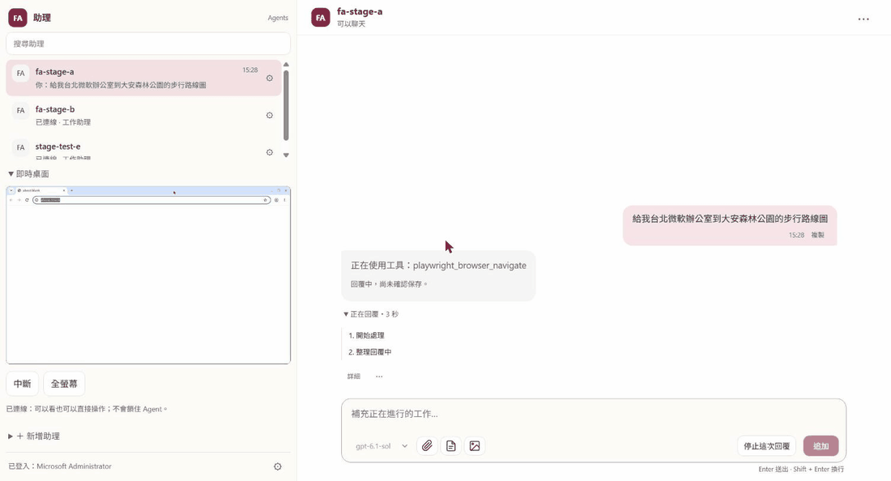

# 🤖 FA Agent 🤖

繁體中文 | [English](README.en.md)

> 在 Microsoft Foundry 上代管的 AI 助理團隊。每位助理有自己的身份、私人記憶，以及一台帶桌面和瀏覽器的 Linux VM。



## FA Agent 是什麼？

FA（Foundry Agents）是給單一組織使用的代管 AI 助理平台。一個 Team 屬於一位使用者，Team 裡可以有好幾位助理，每位助理有自己的角色、記憶和工具。資料模型可以放很多個 Team，但目前一套部署只設定一個 Team、一位 Team 主人；讓多個 Team 各自獨立運作的部分已有設計，部分已實作、還沒部署。

每位助理在 [Microsoft Foundry Hosted Agents](https://learn.microsoft.com/azure/foundry/agents/concepts/hosted-agents) 上有自己的一台 VM。回合由固定版本的 [GitHub Copilot SDK](https://github.com/github/copilot-sdk) 在 VM 裡執行。它讀你的訊息，呼叫工具，操作桌面上的 Chromium，再把結果寫回對話。

VM 閒置一段時間後由平台回收，FA 預設是 3600 秒，可以在環境設定調整。對話的歷史與 checkpoint 存在 Foundry State store，下一則訊息進來時，新的 VM 從最後一個合法 checkpoint 接續對話。VM 上的工作檔目前不會跟著搬過去。

**和直接用 Foundry agent 或自架 OpenClaw 差在哪。** 直接在 Foundry 建 agent 時，桌面、私人記憶、交辦和權限邊界都要自己接；FA 替每位助理準備一台自己的 Hosted VM（帶桌面和 Chromium）、私人記憶、批准卡，以及同 Team 助理之間的交辦。自架 OpenClaw 跑在你自己管的機器上；FA 全部用你 Azure 訂閱裡的代管服務，以 Team 為信任邊界：入口用 Entra 核對 Team 主人，資料轉送和交辦都只在同一個 Team 內。VM 被回收或換版後，對話從最後一個合法 checkpoint 接續，不會悄悄換成一段新的對話。「比 OpenClaw 快 10 倍」是專案的目標，目前還沒有量測結果。

你在網頁工作台和助理對話。工作台用 Entra ID 登入，只有 Team 主人進得去。

```text
你：給我台北微軟辦公室到大安森林公園的步行路線圖
A ：（在自己的桌面用 Chromium 打開 Google 地圖，查路線並截圖）回覆距離、時間和路線截圖
你：請 B 查一下信義區現在的天氣，我要去運動
A ：（交辦給 B，結束這一回合）
B ：（搜尋天氣，把結果回報給 A）
A ：（被 B 的回報喚醒，在原對話整理天氣和運動建議給你）
```

**需要什麼。** 一個 Azure 訂閱，你在上面能建立資源和角色指派（Owner 最簡單）；一個有 Foundry Hosted Agents 的區域，以及你要用的模型 quota；一個 Entra 租用戶：你要能註冊 app，另外要替 Team 主人建立委派授權：你有 Cloud Application Administrator 以上的角色時 hook 直接建，沒有時 hook 寫出檔案交給管理員做（你不是管理員也能部署）；Team 主人的 Entra 帳號。助理用的是你在 Foundry 部署的模型（BYOK），所以不需要 GitHub 帳號或 GitHub Copilot 訂閱。完整條件和步驟見下方「部署到你的 Azure」。

**費用。** 每位助理的 VM 運作時約 US$0.25／小時，閒置回收後不計；常駐的工作台約 US$5.83／月，API 等其他資源另計。作者環境的估算見下方「費用參考」，實際以你的帳單為準。

## 主要功能

- **自己的桌面和瀏覽器。** 每台 VM 有 Xvfb 桌面、[Playwright MCP](https://github.com/microsoft/playwright-mcp) 和固定版本的 Chromium。在同一台 VM 上，分頁和 cookie 會跨回合保留。你可以在工作台的「即時桌面」用 noVNC 看助理操作，也能直接接手滑鼠和鍵盤。
- **助理之間交辦工作。** 助理 A 用 `send_agent_message` 把工作交給同 Team 的 B，然後結束這一回合。B 排隊處理，做完後喚醒 A，A 在原對話接著回覆你。轉送點只核對雙方是否屬於同一個 Team。
- **私人記憶。** 每位助理的記憶存在 Foundry Memory Store，跨對話可用。另有同 Team 助理共用的 Team note，只收真人在對話裡說過的原話，助理的回覆、工具結果和網頁內容都不會寫進去。
- **真人批准卡。** 需要批准的動作會在對話裡跳出卡片，例如執行 shell 或呼叫 Team MCP。按「允許這次」只放行一次。規則在「Agent Team 設定」裡調整。
- **網頁搜尋與 Team 工具。** 經 [Foundry Toolbox](https://learn.microsoft.com/azure/foundry/agents/how-to/tools/toolbox) 接 WebIQ 搜尋和你自己的 MCP server。FA 另附一個唯讀的 Feed reader MCP，讓助理讀你私人訂閱的 RSS／Atom feed；feed 網址只存在 Foundry 的連線設定裡，助理看不到。
- **排程。** 在對話裡請助理定時做事。助理提出排程，你批准後由 API 的時鐘按時觸發。
- **可換的模型。** 輸入框旁的選單可以切換模型，可選清單在 [`model-catalog.json`](src/fa-shared-context-poc/model-catalog.json)。`azd up` 建的環境也能在對話中途換（換的那一回合會慢一次）；關法見 [deploy/azd](deploy/azd/README.md#model-switch)。
- **在工作台新增助理。** 按「＋」填角色說明就能建一位新助理，只能加進自己的 Team。

以上功能都在作者的測試環境（dev）或預備環境（stage）用真模型跑過，只有排程例外。排程已在 stage 開啟，還沒有真人建過第一個。給維護者看的完整驗收紀錄在 [CURRENT-STATE](docs/status/CURRENT-STATE.md) 和 [progress](docs/progress.md)，用了很多內部代號。

## 運行在哪裡

全部資源都在你自己的 Azure 訂閱裡。回合和模型呼叫在 Hosted VM 內完成。API 只負責入口（身份核對與去重）、Team 資料轉送、跨 VM 交辦、用量入帳、保管組織 connector 的秘密、新增助理、寫入 Team 主人批准過的 SOP、skills 和角色，以及按時觸發已批准的排程。

```text
瀏覽器
  │  Entra ID 登入（Container Apps Easy Auth）
  ▼
工作台 ──────────► FA API ─────────────────► Foundry Hosted Agents
Container App      Container App              每位助理一台 VM
                   · 身份核對與去重           · Copilot SDK 執行回合
                   · Team 資料轉送            · Xvfb 桌面 + Chromium
                   · 跨 VM 交辦               │
                   · 用量入帳、排程時鐘       ├─► Foundry 模型部署
                   │                          ├─► Foundry State store（checkpoint）
                   ▼                          ├─► Foundry Memory Store（記憶）
              Storage Table / Blob            └─► Foundry Toolbox（WebIQ、MCP）
```

| 元件 | Azure 服務 | 來源 |
|---|---|---|
| 助理 VM | Foundry Hosted Agents | [`Dockerfile.behavior-assistant-desktop`](src/fa-shared-context-poc/Dockerfile.behavior-assistant-desktop) |
| API | Azure Container Apps（最少 1 個 replica） | [`Dockerfile.behavior-api`](src/fa-shared-context-poc/Dockerfile.behavior-api)、[`behavior-api.bicep`](infra/shared-context/behavior-api.bicep) |
| 工作台 | Azure Container Apps + Easy Auth | [`web_test_console/`](src/fa-shared-context-poc/web_test_console)。`azd up` 的 postdeploy 會建立（[deploy/azd](deploy/azd/README.md)） |
| Feed reader MCP | Azure Container Apps | [`feed_mcp/`](src/fa-shared-context-poc/feed_mcp)、[`feed-mcp.bicep`](infra/feed-mcp/feed-mcp.bicep) |
| 工作狀態與成果 | Storage Table、Blob | [`foundation.bicep`](infra/shared-context/foundation.bicep) |
| 即時推送 | Web PubSub（只允許 Entra） | [`realtime.bicep`](infra/shared-context/realtime.bicep) |
| 監控 | Log Analytics、Application Insights | [`stage-monitoring.bicep`](infra/shared-context/stage-monitoring.bicep) |
| 映像 | Azure Container Registry | [`foundation.bicep`](infra/shared-context/foundation.bicep) |

主要固定版本有 `github-copilot-sdk==1.0.13`、Copilot runtime 1.0.83（SDK 在 VM 裡啟動的執行檔，建映像時下載並固定）、`azure-ai-agentserver-core==2.2.0` 和 `azure-ai-projects==2.3.0`。Hosted 的版本在 [`requirements-hosted.txt`](src/fa-shared-context-poc/requirements-hosted.txt)，API 的版本在 [`requirements.txt`](src/fa-shared-context-poc/requirements.txt)。

<a id="deploy-to-your-azure"></a>
## 部署到你的 Azure

用 `azd up` 部署到你自己的訂閱。Bicep 建立全部資源，hook 呼叫的是作者 stage CI 同一批腳本；之後再跑 `azd deploy`，就是同一套升級步驟。完整說明在 [deploy/azd/README.md](deploy/azd/README.md)，設計取捨在 [docs/azd-new-environment.md](docs/azd-new-environment.md)。網路預設是 `public`；要讓 Foundry 資料面不經公網，見下方[私有化部署](#private-deployment)。

**事前準備，看由誰來做。** 每一項的細節見 [事前準備](deploy/azd/README.md#prerequisites)。

- **你（部署的人）**：azd 1.32.0 以上、Azure CLI、Python 3.11 以上、git 和正在執行的 Docker，Windows 另需 PowerShell 7。`az` 和 `azd` 用同一個使用者帳號登入。建議你就是 Team 主人；不是的話，後半段要由主人登入接手。
- **訂閱 Owner**：你在訂閱上要有 Owner，或 Contributor 加 User Access Administrator。訂閱要註冊 9 個 resource provider 和 1 個 feature（名稱與 `az` 指令見 [deploy/azd/README.md](deploy/azd/README.md#register-providers)）；preprovision hook 只檢查、不會替你註冊。
- **Entra 權限**：允許你註冊 app。Team 主人一人的 3 筆委派授權，你能建（Cloud Application Administrator、Application Administrator 或 Global Administrator）時由 hook 直接建好；不能建時 hook 把請求寫成給管理員的檔案（`.azure/<env>/fa/admin-consent/`），管理員做完後你再接續。

不需要 Microsoft Teams、Work IQ 或 GitHub。`azd up` 完成時 connector 是關的，之後要加工具見 [擴充](#extending)。

```powershell
git clone https://github.com/neallee2012/fa-agent.git; cd fa-agent   # 要用 git clone，不要下載 ZIP：部署會讀 git commit（git rev-parse HEAD）
$env:AZURE_CONFIG_DIR = "$HOME\.azure-fa"   # 獨立的 Azure CLI 設定目錄，避免誤用別的訂閱
$env:PYTHONUTF8 = "1"
az login --tenant <your-tenant-id>
azd auth login --tenant-id <your-tenant-id>
azd env new <name> --subscription <subscription-id> --location <region>
azd env set FA_TEAM_OWNER_OID <owner-object-id>   # Team 主人的 object ID（查法見下段）；只有你自己就是主人時才可略過
python .\deploy\azd\fa_azd.py prereq     # 唯讀：列出你已具備什麼、還缺什麼、該找誰
azd up
```

這組步驟的完整版本（含 bash 寫法與選用項目）只有一份，在 [deploy/azd/README.md](deploy/azd/README.md#first-deploy)。上面是 PowerShell 寫法；若在 Windows 的 Git Bash 裡設 `AZURE_CONFIG_DIR`，曾觀察到 `$HOME/.azure-fa` 這類路徑被改寫、多出一個 `C:\c\Users\<你>\.azure-fa` 資料夾（不保證每台都會發生）。建議用 PowerShell；一定要用 Git Bash 時，改用 Windows 形式的路徑，例如 `C:/Users/<你>/.azure-fa`。

`<name>` 是環境名稱，2～20 個小寫字母、數字或連字號，會當資源名稱的前綴。`<region>` 要選有 Foundry Hosted Agents 的區域，清單見[官方文件](https://learn.microsoft.com/azure/foundry/agents/concepts/hosted-agents#region-availability)。還沒決定區域時，可以拿掉 `--location`，`azd up` 會用選單問你；`prereq` 不讀區域，有沒有 `--location` 都能跑，不想跑它才拿掉那一行。

不知道訂閱 ID 或租用戶 ID 時，`az login` 後執行 `az account list --query "[].{name:name, id:id, tenant:tenantId}" -o table`。訂閱在 `azd env new --subscription` 時就固定在該 azd 環境，不使用 az CLI 的預設訂閱；hook 會檢查 az 與 azd 登入的是同一個租用戶，不同就停止。

要多久依區域與當時平台狀況而定：2026-10-15 那次第一次 `azd up` 約 1.5～2 小時、之後再跑約 15 分鐘；2026-10-21 用第 34 版從頭跑，provision 約 10 分鐘，首次安裝另外等了三次 Job log、合計約 20 分鐘（整體總時間沒量）。`azd up` 一開始就停在「interactive prompts disabled … missing location」時（例如在 Claude 桌面 app 的終端機分頁裡），先 `$env:AZD_NON_INTERACTIVE = 'false'` 再跑。Windows 上 `az login` 的帳號挑選視窗找不到要用的帳號時，改用 `az login --tenant <your-tenant-id> --use-device-code`。細節見 [第一次部署](deploy/azd/README.md#first-deploy)。

主人的 object ID 用 `az ad user show --id <主人 UPN> --query id -o tsv` 查（主人自己登入時，`az ad signed-in-user show --query id -o tsv` 也行）。沒設 `FA_TEAM_OWNER_OID` 時，部署的人會成為 Team 主人，主人以外的人登入不了工作台，要 `azd down --purge` 才能重來。所以 preprovision 會印出「Team owner = 目前登入的部署者」，在終端機裡要你輸入 `y` 確認，其他回答就停下、什麼都不寫。`azd up` 一開始會再跑同一份檢查，缺東西就在建立任何計費資源前停下。

**中途要你回答的地方。**

- **區域與模型。** 區域由 azd 的選單問，只列有 Foundry Hosted Agents 的區域；上面用 `--location` 指定過就不再問。作者使用 `westus3`；2026-10-21 在那裡因為 gpt-6 系列 quota 是 0，改選 `gpt-5.4-mini` 跑完第一次部署並通過「前 10 分鐘」檢查。模型由 hook 列出這個區域有沒有提供、quota 夠不夠，你輸入編號，再選新對話的預設模型。沒有固定必裝的模型。有的區域某些模型的 quota 是 0，建議 `azd up` 前先查 quota，或用 `azd env set FA_MODELS …`、`FA_DEFAULT_MODEL …` 預先選好，查法見 [deploy/azd 的「區域與模型」](deploy/azd/README.md#region-and-models)。
- **首次安裝批准。** 首次安裝寫入資料表前，終端機會顯示 request、installation、configuration 與 plan hash，Team 主人輸入 `y`（或 `yes`）才會寫入，批准檔綁定 configuration 與 plan 這兩個 hash、10 分鐘內有效。輸入其他內容就停下，什麼都不寫；沒有終端機（程式以 `sys.stdin.isatty()` 判斷，不看 azd 的 `--no-prompt`）時直接停。
- **WebIQ 金鑰（選用）。** 先 `azd env set FA_ENABLE_WEBIQ true` 才會問。金鑰用隱藏輸入，不寫檔，也不進 azd env。

**還要真人做的事。** 部署最後，hook 以 Team 主人身分替兩位助理選好新對話的模板：走 Responses，開啟伺服器提供的全部能力。之後可以在工作台助理 ⚙ 設定頁調整。剩下的是主人登入 hook 印出的工作台網址（hook 的訊息裡叫 Portal，就是工作台；之後用 `azd env get-value FA_CONSOLE_URL` 也查得到），開新對話送一則短訊息；回條 `completed`、`failure_code=null` 才算通過，步驟見下方 [前 10 分鐘](#first-10-minutes)。部署的人不是主人時，第一次 session 準備和模板選擇要由主人登入後跑 `azd hooks run postdeploy`。主人接手從批准首次安裝開始；重跑時會重做角色指派和 Bicep，所以主人也要有訂閱 Owner（或 Contributor 加 User Access Administrator）和 Foundry User，並在同一台電腦、用同一個 `.azure/<env>/fa` 資料夾執行。

**中斷或要排錯時。** 每個寫入都先記 intent。照畫面提示讀回，再用 `azd hooks run postprovision` 或 `azd hooks run postdeploy` 接續，不要刪掉重來；在新的終端機接續時，先設同一個 `AZURE_CONFIG_DIR` 並 `cd` 到 repo 根目錄，見 [中斷後接續](deploy/azd/README.md#resume)。逐步排錯的對照是 [新環境標準流程](deploy/README.md#new-environment-standard-flow) 的 17 個關卡，兩邊呼叫同一批腳本。

**目前的限制。** 作者在自己的訂閱從頭跑完一次 `azd up`，並在工作台實際使用過。開頭的區域與模型選擇之後也在 eastus2 實跑成功（只選一個模型，部署與設定讀回正確），但那次的工作台驗收還沒做。2026-10-21 又用公開 repo 第 34 版在 westus3 從頭跑一次，前 10 分鐘驗收通過。

**費用參考。** 這些是作者環境的估算，實際以你的帳單為準。每位助理的 VM 運作時約 US$0.25／小時（2 vCPU、4 GiB），閒置回收後不計。常駐的工作台約 US$5.83／月。記憶功能預設開啟，Memory Store（preview）依用量另計。作者的 stage 環境原本估算每月 US$70～190，2026-10-07 起工作台和 feed app 改成常駐，每月約再多 US$11.66。

**不用了怎麼拆。** `azd down --purge` 會刪掉整個資源群組（連同資料表、備份和記憶，無法復原）和這個環境建的 Entra app，約 30 分鐘。備份鎖還在且沒設 `FA_CONFIRM_DELETE` 時，會先要你輸入環境名稱；確認步驟、沒有終端機時的做法見 [deploy/azd 的「刪除」](deploy/azd/README.md#刪除)。

<a id="private-deployment"></a>
## 私有化部署（`FA_NETWORK_MODE=private`）

`private` 比較適合有高資安、金融監理（金管）或其他法遵要求的企業用戶，例如需要 Foundry 的資料面（模型與 agent endpoint）不經公網、要自己控管網路出入的組織。一般使用或試用請維持預設的 `public`。`private` 提供的是網路隔離的基礎元件，不會讓你因此就符合任何法規；是否合規，仍取決於組織自己的控管與評估。

**做到什麼。** 第一次 `azd up` 前設 `FA_NETWORK_MODE=private`：

- Foundry 帳號關閉公網，帳號、project 的資料面與 agent endpoint 只能從你的 VNet 經 private endpoint 進入。
- Hosted Agent 注入你控管的 subnet，可以自己加 NSG、route table 或防火牆。
- 工作狀態與成果（Storage Table、Blob）和 `public` 一樣照舊只走 private endpoint；長期記憶（Cosmos DB serverless）也只走 private endpoint。
- 部署時有幾個步驟要從你的電腦呼叫 Foundry 資料面，hook 會暫時開一個只允許你這台電腦 IP 的窗口，做完自動關閉並讀回確認。
- 選用：帶入既有 VNet（`FA_VNET_RESOURCE_ID` 加三個 subnet 名稱）；DNS 可以由 FA 建（`FA_DNS_MODE=azd`，預設），或由你的 hub 管（`existing`）。

**做不到什麼。** `private` 不是全內網：

- 工作台和 FA API 的入口仍在公網，靠 Entra 登入保護。
- Hosted Agent 到 FA API 的 Team 資料（含記憶）走公網，以 TLS＋Entra 保護：azd 建的 VNet 經它建的 NAT 出站；帶入既有 VNet 時經你的 NAT 或防火牆。
- azd 建的 VNet 沒有出站過濾：經 NAT 出站，來源 IP 固定，目的地不限；要限制請自己加 NSG 或防火牆。帶入既有 VNet 時，來源 IP 和過濾由你的 NAT 或防火牆決定。
- ACR（Basic）、Web PubSub，以及送到 Log Analytics／Application Insights 的資料擷取仍在公網（背景見 [ADR-0010](docs/adr/0010-azd-private-network-option.md)）。
- 部署時的暫時窗口只允許你這台電腦的公網 IP；你的電腦若在公司、校園或 VPN 共用的出口 IP 後面，窗口開著的這段時間，同一出口的所有人都連得到這個帳號的資料面（仍要 Entra 身分與 Foundry 角色）。開了 WebIQ（`FA_ENABLE_WEBIQ=true`）時，之後每次升級都會再開一次窗口。見[部署期間的暫時窗口](deploy/azd/README.md#private-deploy-window)。
- 不能用 Foundry Memory Store，長期記憶改用 FA 自建的 Cosmos DB 記憶。
- 不支援 Work IQ，也不支援入口網站的 Teams 一鍵發布。
- 只能在建立環境時選，之後不能切換；要換就另建一個環境。主人也不能再從公網用 Foundry 入口網站看 Agent 與資料。
- 全私有（`isolated`）是之後的工作：工作台與 API 也進內網，並改用私有 ACR 與 AMPLS（Azure Monitor Private Link Scope）。

**怎麼開。** 在上面 `azd env new` 之後、`azd up` 之前：

```powershell
azd env set FA_NETWORK_MODE private
# 選用：帶入既有 VNet（要放在另一個 resource group；subnet 名稱和預設不同時才設，另有 FA_API_SUBNET_NAME、FA_PRIVATE_ENDPOINT_SUBNET_NAME）
azd env set FA_VNET_RESOURCE_ID /subscriptions/<subscription-id>/resourceGroups/<network-rg>/providers/Microsoft.Network/virtualNetworks/<vnet>
azd env set FA_AGENT_SUBNET_NAME <agent-subnet>
azd up
```

訂閱要另外註冊 `Microsoft.ContainerService`；記憶開啟時（預設）也要註冊 `Microsoft.DocumentDB`。區域要在 Agent Service 的區域表裡。preprovision 只讀檢查這些和 VNet 的大部分條件，不符就停下、什麼都不寫；但帶入的 subnet 沒有 NAT 或 route table 只會警告，VNet 已連的同名 DNS zone 和 peer VNet 的位址重疊不會檢查，要你自己確認。帶入的 VNet 要事先準備的 subnet、出站與權限，以及 DNS 的兩種做法，見 [deploy/azd 的「網路模式」](deploy/azd/README.md#network-mode)與[「帶入既有 VNet」](deploy/azd/README.md#byo-vnet)；設計與取捨見 [ADR-0010](docs/adr/0010-azd-private-network-option.md) 和 [ADR-0011](docs/adr/0011-private-mode-cosmos-memory.md)。

**費用。** 比 `public` 多一筆固定月費。以下是 ADR 依牌價做的估算，實際金額還沒從帳單核對：NAT Gateway、它的公網 IP、Foundry 的 private endpoint 與 DNS zone 每月約 US$50，再加資料處理費（[ADR-0010](docs/adr/0010-azd-private-network-option.md#waf-五大支柱)）；Cosmos DB 記憶的 private endpoint 與 DNS zone 每月約 US$8；Cosmos 本身的 RU 與儲存估計每月不到 US$1，儲存隨資料逐月累加（[ADR-0011](docs/adr/0011-private-mode-cosmos-memory.md)）。記憶抽取的模型費用依回合數計，但不是 `private` 才有：`public` 的 Memory Store 也用模型抽取。帶入既有 VNet 時，出站（NAT 或防火牆）由你自己提供。

**驗證到哪裡。** 2026-10-24 在作者的測試訂閱雲端驗收核心流程：azd 建的 VNet，以及帶入既有 VNet 搭配 `FA_DNS_MODE=azd`，都跑完 `azd up`、[前 10 分鐘](#first-10-minutes)、長期記憶的寫入和新對話回想，以及 `azd down`（紀錄：[第一輪](docs/progress.md#private-e2e-1024)、[兩輪重跑](docs/progress.md#private-reruns-1024)）。三次部署（`fa-priv-1024`、`fa-priv2-1024`、`fa-byo-1024`）的部署窗口都有開關，hook 每次都印出 "closed again (read back: publicNetworkAccess Disabled, no IP rule)"（重跑兩輪的讀回記在作者的執行紀錄，見[兩輪重跑](docs/progress.md#private-reruns-1024)）。帶入既有 VNet 的 `azd down` exit 0，拆除後客戶 VNet 三個 subnet 都在、兩個委派 subnet 的委派仍在，不留 FA 的 service association link 或 private endpoint。帶入既有 VNet 只測過一種網路拓撲；`FA_DNS_MODE=existing` 還沒在雲端測過。

**要多久。** 測試中第一次 `private` 的 `azd up` 約 1.3～1.5 小時（10-24 兩輪重跑；最早那一輪含首次安裝的等待，約 1.9 小時）。帶入既有 VNet 那次，Foundry 帳號與 project 的建立比 azd 建的 VNet 慢很多（各約 20 分鐘，另一輪約 4～6 分鐘）；只觀察到一次，原因未知。刪除要照順序，10-24 的三次測試中，從開始拆除算起約 50～60 分鐘（其中 azd 自己印出的時間約 24～31 分，不含 predown 刪 Foundry 帳號等它消失的那段；`fa-priv-1024` 第一次停在傳播延遲的競態、重跑才完成）；刪帳號時遇到「project 還列著」的傳播延遲，hook 會自動等一段時間再送一次。見 [`private` 的刪除](deploy/azd/README.md#private-down)。

<a id="first-10-minutes"></a>
## 前 10 分鐘

部署完成後，由 Team 主人照下面走一次，確認整條路是通的。

1. 執行 `azd env get-value FA_CONSOLE_URL` 取得工作台網址，用瀏覽器打開，以 Team 主人的 Entra 帳號登入。
2. 左側助理清單選 `fa-<name>-a`（助理 A）。
3. 按對話上方的「⋯」→「新對話 · New session」。
4. 在「傳送訊息…」輸入一則會用到 shell 的訊息，例如「用 shell 執行 `date`，告訴我結果」，按「送出」。
5. 如果對話裡跳出批准卡，按「允許這次」，助理接著做完並回覆。新部署的 Team 還沒有批准規則，而且自動審查會放行你明確要求的唯讀指令，所以 `date` 這類指令可能不跳卡，助理直接回覆也是正常的，不是部署壞了。想看到批准卡：到助理的 ⚙ 設定頁「批准規則」→「新增一條規則」，內容寫「shell 指令」，「遇到符合的動作時」選「先問我」，按「確認並新增規則」，再送一次訊息。
6. 按「⋯」→「支援明細」，展開「識別碼、歷史與回條」：`native_receipt` 的 `status` 是 `completed`、`failure_code` 是 `null`，就算通過。有沒有跳批准卡都看這裡；回覆出現但 `status` 不是 `completed`，就不算通過。

## 快速開始

不需要 Azure 也能跑離線測試，並在本機看工作台的介面。

```powershell
# 建虛擬環境並安裝測試依賴
python -m venv .\src\fa-shared-context-poc\.venv
.\src\fa-shared-context-poc\.venv\Scripts\python.exe -m pip install -r .\tests\shared_context\requirements.txt -r .\src\fa-shared-context-poc\requirements-behavior.txt

# 跑一組離線測試，不需要 Azure 認證
.\src\fa-shared-context-poc\.venv\Scripts\python.exe -m pytest .\tests\shared_context\test_native_toolbox.py -q -p no:cacheprovider --basetemp "C:\t\fa-$(Get-Random)"

# 本機預覽工作台，開 http://127.0.0.1:8765/
cd .\src\fa-shared-context-poc
.\.venv\Scripts\python.exe -B -m web_test_console preview --port 8765
```

預覽模式不取 token、不連後端，所有操作都停用，只用來看介面。`--basetemp` 指到每次不同的短路徑：短是為了避開 Windows 的路徑長度上限，每次不同是因為 pytest 會清空這個目錄。完整的 `tests\shared_context` 在作者的 Windows 電腦上跑超過一小時，寫法見 [本機命令](src/fa-shared-context-poc/README.md#本機命令)。

## 調整你的助理

| 想改什麼 | 在哪裡改 |
|---|---|
| 助理的角色 | 工作台按「＋」新增助理時填寫，上限 2048 bytes |
| 能力、skills、MCP | 助理列的 ⚙ →「套用到新對話」，只影響新對話 |
| Team skills | 左下 ⚙「Agent Team 設定」→ Team Skills。草稿要 Team 主人批准指定版本才生效 |
| 批准規則 | 「Agent Team 設定」→「批准規則」 |
| Team MCP server | 「Agent Team 設定」→ Team MCP，寫入官方 Toolbox |
| 預設模型與可選模型 | 環境設定的 `FA_INSTRUCTION_DEFAULT_MODEL`，以及 [`model-catalog.json`](src/fa-shared-context-poc/model-catalog.json) |
| 系統提示版本 | 環境設定的 `conversation_defaults.prompt_profile`，全文在 [`behavior_instruction_prompt.py`](src/fa-shared-context-poc/shared_context/behavior_instruction_prompt.py) |
| 工具定義 | [`tool_catalog/`](src/fa-shared-context-poc/tool_catalog) |
| 環境開關 | 環境 profile JSON，用 `--config` 或 `FA_DEPLOY_CONFIG` 指定。Hosted 的環境變數要隨新的 Hosted 版本一起發布 |

<a id="extending"></a>
## 擴充：MCP、skills 與 connector

完整步驟和程式位置在 [docs/extending.md](docs/extending.md)。

- **MCP server。** 用金鑰（header）驗證的遠端 MCP，由 Team 主人在「Agent Team 設定」→ Team MCP 加入，不用改程式；再到助理 ⚙ →「MCP」打開。要在助理 VM 裡跑本機（stdio）MCP，就在 [`tool_catalog/`](src/fa-shared-context-poc/tool_catalog) 加一個 JSON，把執行檔裝進 Hosted 映像，再 `azd deploy`。
- **Skills。** 在「Agent Team 設定」→ Team Skills 寫草稿，Team 主人批准指定版本才生效；改內容就寫新版，舊版保留。再到助理 ⚙ →「Skills」選用。工作台沒有寫 SOP 的入口，流程寫成 skill 即可。角色在按「＋」新增助理時填寫；azd 新環境預設就會備好「＋」需要的權限；若用 `azd env set FA_ENABLE_AGENT_ONBOARDING false` 關掉，新助理會缺少執行需要的設定和權限。
- **Plugin。** FA 沒有 plugin 機制。助理 ⚙ 裡的「Plugins」分頁是 FA 內建能力（桌面、shell、交辦等）的開關，不能安裝新的。
- **Connector 是選用的。** `azd up` 不需要 Teams、Work IQ 或 GitHub，完成時 connector 是關的，Team MCP 是開的。目前只有 Microsoft Teams（經 Work IQ）一種，要自備 Entra app 並在 API 設 `FA_TEAM_CONNECTORS_ENABLED=1`；azd 環境還沒有對應的設定，沒驗證過。
- **加自己的 connector。** 金鑰驗證的服務直接用 Team MCP。Entra OAuth 的服務要在 [`connector_registry.py`](src/fa-shared-context-poc/shared_context/connector_registry.py) 加一筆 `ConnectorRef`，只改設定不行。這條路還沒有人實際做過。

<a id="in-development"></a>
## 開發中的功能

下面的功能已經有程式，但還沒在每個環境驗收，`azd up` 也不會替你打開。

- **Microsoft Teams connector（經 Work IQ MCP）。** 助理能讀 Teams 的聊天和頻道訊息，也能代你發訊息；發訊息預設每次都要你在批准卡上按允許。已在作者的測試環境用真人走過，`azd up` 建的環境預設關閉。步驟見 [開啟 Teams connector](docs/extending.md#開啟-teams-connector)，驗收到哪裡見 [驗收紀錄](docs/extending.md#connector-acceptance)。
- **在 Teams 裡和助理對話（Teams relay）。** 在 Teams 直接傳訊息給助理，助理在自己的 VM 跑回合並把回覆送回 Teams；需要批准時回覆「允許 代碼」或「拒絕 代碼」，輸入 `/foundry_new_preview` 開新對話，都已在作者的測試環境從 Teams 實測。超過約 110 秒才完成的回覆，會附在你下一則訊息的回覆裡（「先前的回覆（剛完成）：」，開了新對話也一樣），通常只附一次；萬一無法確認 relay 收到，寧可之後再附一次也不遺失。這部分只有程式與離線測試，還沒部署。預備環境沒開，也還沒有部署腳本；設計、限制和步驟見 [Teams 對話設計](docs/teams-chat-design.md) 與 [relay 說明](src/fa-teams-relay/README.md)，實測紀錄見 [progress](docs/progress.md#teams-relay-observed-1011)。
- **GitHub connector。** 還在設計，程式裡沒有。見 [connector 設計](docs/connector-design.md#分階段)。

## 文件

📖 第一次看 FA，先讀 [領域用語](CONTEXT.md) 和 [需求](docs/requirements.md)，完整文件導覽在 [docs/README.md](docs/README.md)。要參與開發或維護的人，再讀 [AGENTS.md](AGENTS.md) 和 [CURRENT-STATE](docs/status/CURRENT-STATE.md)，這兩份寫給維護者，用了很多內部代號。

- **概念**：[領域用語](CONTEXT.md) · [需求](docs/requirements.md) · [規格](docs/specification.md)
- **架構決策**：[Team 信任邊界](docs/adr/0006-team-trust-boundary-grokbot-mode.md) · [優先用 Foundry Hosted 原生能力](docs/adr/0007-foundry-hosted-native-first.md) · [環境分層與 CI/CD](docs/adr/0008-environment-tiers-staging-cicd.md)
- **實作**：[API 與 Hosted](src/fa-shared-context-poc/README.md) · [工作台](src/fa-shared-context-poc/web_test_console/README.md) · [行為控制規格](docs/FA-AGENT-BEHAVIOR-SPEC.md)
- **部署**：[部署流程](deploy/README.md) · [Connector 設計](docs/connector-design.md)

## 參與開發

開工前先讀 [AGENTS.md](AGENTS.md) 的架構界線（寫給貢獻者與維護者），以及 [CONVENTIONS](docs/CONVENTIONS.md) 對應的段落。改動走 feature branch 和 PR，不直接推 `main`。

```powershell
git switch -c <your-branch>
.\src\fa-shared-context-poc\.venv\Scripts\python.exe -m pytest .\tests\shared_context\<改到的測試檔> -q -p no:cacheprovider --basetemp "C:\t\fa-$(Get-Random)"
```

## 遙測

Hosted 預設把 Copilot SDK 每一回合的 trace 送到你 Foundry project 連結的 Application Insights，內容包括訊息文字。設 `FA_SDK_TELEMETRY=0` 可以關閉。助理用到的外部工具（例如 WebIQ 搜尋、Work IQ、你自己加的 MCP server）會把請求送到各自的服務。實作在 [`sdk_telemetry.py`](src/fa-shared-context-poc/shared_context/sdk_telemetry.py)。

## 社群

問題與建議歡迎開 Issue 或送 PR。

## 授權

FA 以 [MIT License](LICENSE) 授權。

---
