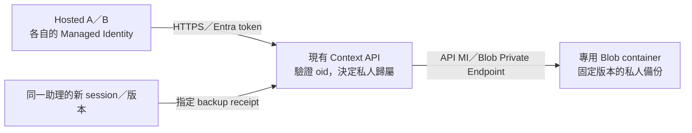

# M1 雲端私人環境備份：儲存、授權與端到端驗收

日期：2026-09-14。**以下資源與授權已部署，M1私人環境端到端驗收已在原批准額度內完成。**
[實際結果](M1-PRIVATE-ENVIRONMENT-POC.md)分列第一段版本重用失敗與成功續跑；
結論來自真正Hosted的profile／工具／隔離及恢復，不是只看設計、Blob存在或HTTP200。

## 採用的方向

使用**專用Azure Blob Storage帳號保存應用層備份**，由既有Context API代理存取。
不是File Share、Blob掛載或Azure Backup／Backup Vault產品；Foundry仍Non-VNet，保留Memory Store使用條件。
本機只保留測試證據與receipt，**不作備份套件的還原來源，也不在雲端失敗時退回本機副本**。



不將profile／cookie塞進Table、Memory或Team context。Table仍是共享工作狀態的權威來源，
Memory仍用於語意記憶；私人環境備份是不同用途。

## 儲存與網路

| 項目 | 設計 |
|---|---|
| Azure範圍 | 原subscription、`rg-faexample`、West US 3；US$100總預算不變 |
| 專用帳號 | 已建立`stfam1backupdemo`，StorageV2／Standard_LRS／Hot |
| Container | `m1-environment-backups`；不公開、不允許匿名讀取 |
| 網路 | 新增1個`blob` Private Endpoint至既有`vnet-facontext-api`／`snet-private-endpoints`；必要的Blob private DNS zone、VNet link及zone group |
| 安全設定 | `publicNetworkAccess=Disabled`、`allowSharedKeyAccess=false`、`allowBlobPublicAccess=false`、HTTPS、TLS1.2以上；不加公網例外或SAS |
| 資料保護 | Blob versioning、Blob與container soft delete各7天；備份帳號加`CanNotDelete` lock |
| 加密 | Azure Storage預設靜態加密，沿用infrastructure encryption基線；不新增Key Vault／CMK或真實登入資料 |
| 保留 | 已存在的備份不自動刪除；7天指**刪除後**的soft-delete窗口，不是備份建立7天後自動清掉 |

選擇**獨立帳號而非擴充現有Table帳號**，是為了隔離Blob versioning／保留設定、授權與清理操作，
不讓備份功能改動既有工作狀態儲存的全帳號行為。LRS適合此合成POC，但不代表跨區域災復。
若Blob DNS zone已存在，僅增必要連結／記錄，不覆寫無關設定。
應用仍使用標準`<account>.blob.core.windows.net`名稱，由API所在VNet的DNS解析到private IP。[S1]

現有Table Private Endpoint**不能代替Blob Private Endpoint**；官方要求每個儲存子服務分別建立。[S1]
新網路用additive部署，不重建既有VNet／Container Apps environment或重新套用整份foundation。

## 授權：只有 API MI 取得 Blob 讀寫

| 主體 | 允許 | 不新增的權限 |
|---|---|---|
| Hosted A／B MI | 以既有Entra驗證呼叫Context API；只能存取自己oid所屬的備份 | Blob／Table／Memory原生資料權限、SAS、Storage keys |
| `id-facontext-api` MI | 只在新container取得Blob read／write；沿用`ManagedIdentityCredential` | Blob／container delete、帳號管理、RBAC管理、user-delegation key生成 |
| 操作者 | 在此次指定範圍建立資源／角色，執行合成驗收、保留receipt | 不為方便而新增自己的Blob資料角色、不修改全域Azure登入 |

現行API MI principal為`00000000-0000-0000-0000-000000000028`；部署前核對，不能用client ID代替principal ID。
已建立自訂角色`FA M1 Backup Data Read Write`，`Actions=[]`，只有：

```text
Microsoft.Storage/storageAccounts/blobServices/containers/blobs/read
Microsoft.Storage/storageAccounts/blobServices/containers/blobs/write
```

role definition的assignable scope限制在本RG；**唯一role assignment設在新container**，不授予整個帳號／RG的資料存取。
建立／指派角色前確認操作者有必要管理權限；不足時停止，不改用更大的內建角色或Shared Key。
已唯讀核對內建`Storage Blob Data Contributor`包含刪除及其他操作，所以這次不直接使用它。
上述read也可能涵蓋Blob列舉；不宣稱它是單一Blob或「不能list」的RBAC。
另外檢查API MI的直接／繼承授權；自訂角色未列delete**不會抵銷別處已授予的delete**。[S2]

API沿用現有RS256、tenant、issuer、audience、expiry及oid allowlist驗證。
儲存namespace由驗證後的`Actor.oid`及伺服器設定決定，不能接受body／header指定另一位owner或任意Blob URL。
同一助理換session／相容版本可恢復；另一位助理即使知道backup ID／hash，也不得取得內容。
刪除再重建助理造成oid／GUID更換時，不自動接管舊備份。

**這仍信任中央API及其程式。** 容器級RBAC不能替同一API MI區分A/B；
A/B私人隔離由API的逐請求授權負責，須以真實交叉讀取案例驗收。這不是零信任於API的加密隔離。

## 保存與還原契約

保存清單是此POC的`work.txt`、`tool-settings.json`、checkpoint及乾淨關閉的測試Chromium profile。
工具執行檔由immutable image提供，不封裝整個HOME、程序RAM／socket、系統憑證、Azure登入cache或真實網站登入資料。
profile中的必要檔案保留，暫存／lock／socket的排除規則須明列；不能默默丟掉重要資料以通過大小限制。

1. 同一environment鎖下確認browser已乾淨關閉，再產生有界封存件與manifest。記錄來源助理、session、版本、工具基線、保存清單及逐檔hash。
2. Hosted以自己的MI送至API；API從已驗證oid決定歸屬。採唯一backup ID、create-only條件，不覆寫既有備份。[S3]
3. Blob寫入後取得`version_id`／ETag／bytes／SHA-256。receipt只有在實際儲存結果確認後才成功；不把「已送出」當作已備份。metadata與內容盡可能同一次建立，不額外做Table／Blob雙寫交易。
4. 新session由UID10001透過API讀取**receipt固定的Blob版本**，另比對操作者保存的hash。原session須已idle，還原不能依賴它仍在執行。
5. 封存件作為不可信資料驗證：限制大小、檔數、路徑與型別；拒絕symlink／hardlink／裝置檔／path traversal，不直接`extractall`或執行備份內容。
6. 先在有界記憶體內驗完整封存件，再以不覆寫的方式建立全新run；既有資料或半成品不自動覆蓋。以當前非root使用者建立檔案，不照封存件恢復root ownership／setuid bits。checkpoint最後由同目錄暫存檔透過`os.link`原子no-clobber發布；此路徑已在真正Hosted還原通過。
7. 只有明確restore流程能將source binding轉成target binding，留下來源checkpoint hash與新的receipt；普通`read`仍拒絕session／版本不符。
8. 最後真正啟動Chromium，觀察原cookie與語言設定，啟動工具驗證設定生效，再做stop/resume及新程序檢查。僅比較封存件hash不夠。

版本ID指向的Blob內容本身不可修改，但這**不是已設定WORM／legal hold的備份保險庫**。[S4]
soft delete／versioning與帳號delete-lock提供不同層次的保護；lock不等於data-plane刪除禁止，
也不承諾防止有足夠權限的管理員移除保護。[S5]
真實網站cookie或token即使檔案保留，也可能正常到期；不能外推本輪合成cookie的短時間恢復結果。

## 程式 Module 與 Interface

將封存／驗證／安全提交集中在私人環境備份Module，對controller只提供`backup`、`restore`及小型receipt；
Blob版本、owner namespace及條件寫入留在儲存Module內，使用Azure Blob Adapter。
測試跨同一Interface，另外以memory Adapter及錯誤注入驗證衝突、損壞與失敗保留，不把流程散落在controller。

既有Context JSON路由維持64 KiB限制。新增備份專用傳輸路徑先驗JWT，再有界讀取；
暫定封存件上限8 MiB、展開總量64 MiB、2000個regular files，超過即明確拒絕，不全域放大request限制。
不公開任意下載URL、owner切換、刪除或overwrite入口；不把完整profile／token寫進response、trace或log。
使用managed identity、固定目的地、有限timeout及受控重試，回覆遺失先查明狀態，不盲目重送副作用。

## M1 必須實際通過的情境

| 情境 | 證據 |
|---|---|
| A/B各自的完整必要環境 | 合成工作檔、實際套用的工具設定、真正Chromium cookie／語言偏好；均非root |
| warm及stop/resume | 原資料、設定與cookie相符；native idle、新process marker、相同session binding |
| 私人隔離 | B不能讀A私人HOME或A的雲端備份；A也不能取得B的備份；拒絕不得洩漏內容 |
| 真正雲端備份 | API經Blob private IP完成寫入與讀回；native version／ETag及獨立hash相符，不以healthz代替 |
| 替代session | 新A session先證明沒有原資料，再只從Azure備份還原；原A停止；實際工具與browser驗證相符 |
| 版本更新 | 相容工具基線的新Foundry版本，明確記錄image／version差異、source→target binding及還原；不冒稱任意OS／Chromium大版本可直接遷移 |
| 失敗保護 | 錯hash、他人backup ID、重複restore、既有目錄及離線損壞／不安全封存件不得破壞原檔或假成功 |
| 收尾 | 完整前中後session集合；最多2 active；所有本輪新session最後native idle，舊資料與資源不刪除 |

替代session案例不需要刪除原session，也不假裝已等完30天失效期。
此處不包含Copilot SDK對話／業務工作的恢復、自主OS UI、正式排程備份或人工批准產品；那些仍在M2／M3。

## 已批准上限與實際執行

| 項目 | 上限 |
|---|---|
| 新資源 | 1專用Storage帳號與1container、1Blob Private Endpoint及必要DNS、1自訂role及1container級assignment、1備份帳號delete-lock |
| 既有部署更新 | Context API 1個新revision；Hosted A最多2個新version、B最多1個新version，不改Foundry網路或模型 |
| 建置 | 最多3次ACR build：API一次、Hosted最多兩次；逐次保留來源hash與immutable digest |
| Sessions | 最多4個新session，最多2個同時active；舊140筆作為待刷新基準，不任意resume |
| 測試 | 最多40次Hosted invocations、10次stop；模型呼叫0；不重跑舊Memory抽取 |
| 時間 | 每次build／deploy最多20分鐘；整輪session驗收最多60分鐘，保留清理時間 |
| 管理讀取 | 最多80次顯式session／version／inventory觀察；單次idle等待最多30秒／10次查詢 |
| 資料量 | 每份封存上限8 MiB、本輪最多8份；不啟用自動刪除或跨區複製 |
| 費用 | 此次新增測試預留US$10，仍包含於原US$100總額；依執行前帳務與保守估價放行，不把延遲帳務當即時硬封頂 |

使用者已批准此範圍。程式與IaC完成後，what-if只新增批准資源；
已核對操作者Owner、API MI直接／繼承／群組角色及container scope，沒有新增delete權限。
API容器實測Blob DNS解析至PE的`192.168.96.69`；實際上傳及固定版本讀回成功。
API維持原MI／VNet、0.25 CPU／0.5 GiB、min0／max1；Hosted各2 CPU／4 GiB、idle300。

實際用量為2次build、API1個revision、A2個／B1個新version、4個新session、
26次invocations、7次stop、51次管理讀取、模型0。07:15:29–07:28:35 UTC，
含定位與續跑共786.177秒，沒有把續跑當新60分鐘／新額度。
同設定deploy實際重用A8，未算新版本成功；續跑明確加入`PYTHONUTF8=1`產生A9，
只驗相同image的相容設定遷移，不外推任意binary／工具升級。
最後144筆sessions全idle；2份live backups與保留資源未刪除。

執行前06:12 UTC帳務為**US$13.06733675156014597**；
收尾07:31 UTC為**US$13.45929129279025447**。兩者都有帳務延遲，差額不等於本輪成本，
不是即時或最終費用；保留／清理及最終成本仍須另外結清。
官方Retail Prices的實際產品名稱是`Virtual Network Private Link`，Standard Private Endpoint屬`Global`計量，
每小時US$0.01；不是無費率，也不是本輪未使用的Container Apps environment Private Endpoint。
West US 3的`Foundry Agents`／Hosted計量為vCPU每小時US$0.0994、memory每單位小時US$0.0118；
本輪4 vCPU-hours／8 GiB-hours約US$0.492。ACR Basic付費Task vCPU Duration每秒US$0.0001，
按7200 vCPU-seconds預留US$0.72，**不假設仍有免費額度**。
原始價目與估算保存於`.azure\m1-e2e-20260914-1400-retail-*.json`及`-estimate.json`。
Private Endpoint、DNS、Blob、ACR與保留資源仍會計費；session idle不代表全RG零費用，保留超出測試期間須另外核對。

若預算預留不足、policy拒絕、必要角色無法建立、出現意外session、資料不符或收尾無法確認，停止新增操作並保留證據。
不放寬public access、不發SAS、不取消非root／checkpoint防護，也不自動刪除原資料。結束後另確認備份／網路保留與清理。

## 官方依據

- [S1：Storage private endpoints](https://learn.microsoft.com/en-us/azure/storage/common/storage-private-endpoints)：每個子服務分別建立PE，沿用標準Storage hostname與驗證方式。
- [S2：Blob資料角色與container scope](https://learn.microsoft.com/en-us/azure/storage/blobs/assign-azure-role-data-access)：Entra／RBAC、最小scope與custom roles。
- [S3：Blob concurrency](https://learn.microsoft.com/en-us/azure/storage/blobs/concurrency-manage)：強一致性、ETag與條件操作；不指定策略預設last-writer-wins。
- [S4：Blob versioning](https://learn.microsoft.com/en-us/azure/storage/blobs/versioning-overview)：固定version ID、版本不可修改及額外費用。
- [S5：Blob soft delete](https://learn.microsoft.com/en-us/azure/storage/blobs/soft-delete-blob-overview)與[安全建議](https://learn.microsoft.com/en-us/azure/storage/blobs/security-recommendations)：soft delete、container保護、Entra、加密與least privilege。

官方儲存操作是此方案的物件備份依據，**不是Foundry共享filesystem mount的證據**。
