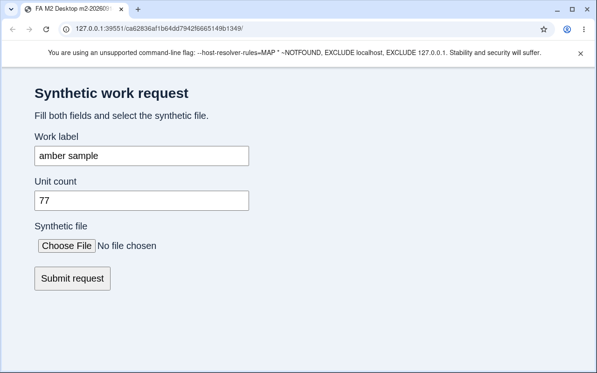

# M2：SDK 助理與自主 UI 的實際結果

日期：2026-09-14。狀態：**PARTIAL／自主 UI 阻擋，完整 M2 尚未通過。**

真正 Hosted 已完成自然語言工作、未完成 checkpoint 的停止／恢復，以及 A→B 檢查與發布。
自主 UI 則未完成：修正工具契約後，模型能填字與開啟原生選檔視窗，但仍重複錯誤定位，
最後數量是 `77` 而非 `7`，沒有選取檔案、提交或下載。已達本輪明列的模型上限，停止付費重試。
這是**此精確模型／工具配置未通過**，不是判定 Foundry 不支援桌面。

## 已完成與未完成

| 測項 | 結果與範圍 |
|---|---|
| 自然語言→模型選工具→成果 | **PASS，A12。** 真正 Copilot SDK 讀 context／合成資料，計算 `12 + 20 + 8 = 40`，保存私人檔案並更新權威工作 |
| 未完成工作的停止／恢復 | **PASS，A12。** `checkpoint_and_wait` 保持 pending 後 native stop／idle；新 process 使用同一 SDK session `00000000-0000-0000-0000-00000000002d` 接續，draft hash 不變 |
| A→B 交接、檢查、發布 | **PASS，A12／B9。** draft revision2、final3、handoff4、B review5／publish6；最後唯讀取回與原發布內容、ETag 完全相同 |
| 私人與原生資料權限 | **PASS，A12／B9。** B 讀 A 私人環境被拒；A/B 的直接 Table／Memory 負向案例被拒，沒有新增原生資料權限 |
| 自主 UI variant0 | **FAIL_FOR_TESTED_CONFIG。** A12 的參數契約錯誤已修正；A13 的49次工具完成均成功，含48次實際動作與49次觀察，但任務成果不成立 |
| 自主 UI variant1 | **NOT_RUN_ALLOWANCE_EXHAUSTED。** 不用第一種版面的部分操作替它背書 |
| 清理與資料保留 | UI 的 browser／window manager／display server 與本地 HTTP server 均完成清理；五個本輪自有 sessions 已 native idle。原失敗、SDK 歷史及已發布工作均保留 |

可直接閱讀 [B 已發布的測試成果](evidence/m2-published-result.txt)。
其 SHA-256 為 `515924eb0f1f33406c91fefa6600fecef00d620fd8e9eaeb6706bdd75e97fc0d`。
A 的 draft／final 為33 bytes，SHA-256：
`4e22d30dd782690f1b9c8e084e49be18b30af155b248dd3587b9dd2868e8bbb5`。

## 真實 UI 失敗畫面

下圖是 A13 最後保留的原始 PNG，不是模擬或重畫：label 正確，但 count 為 `77`，檔案仍未選取。
模型確實曾開啟 native `Open File` dialog；其中多次點擊後畫面 hash 完全相同，未完成選檔。
本輪沒有提供固定座標步驟，也沒有以 DOM、Playwright 或固定 GUI script 代替模型決策。

PNG SHA-256：`28e85bc735c986cb1cb2e2762428cb7156a0e98158e0519189aa121c0a40aef6`。
最後 SDK 原生錯誤包含 `429 model attempt budget is exhausted`。
Native runtime 顯示5次 retry，不代表又向 Azure 上游重送5次；adapter 在第一次失敗後鎖住後續 POST。

## 測過的精確配置

West US 3、Non-VNet Foundry，沿用 Context API／私網 Table／Memory Store。
`github-copilot-sdk==1.0.13`、runtime 發行版 `1.0.83`，
固定 `gpt-4.1-mini`／`2025-04-14`，GlobalStandard capacity500；這不是 PTU。
Windows 與本輪 Linux 的 native session 皆自報 `0.0.0`，沒有改寫成發行版號。

| 用途 | 版本／映像 |
|---|---|
| 通過文字閉環 | A12／B9，Hosted `sha256:f54559651c084dd1497de4696300bee838fe1bf93f86de1c0aebbbddff8611d2` |
| 最後 UI 重測／目前 A | A13，Hosted `sha256:59521480555111716eb5b6f873c3991062aa407cf81f33b3ce575c1f3eebccec`；B 維持9 |
| 目前 API | `ca-facontext-poc--m2-3`，`sha256:f23b6720fbb932a1967955ff36d4f7bb3004adbb15b6eb02f9d1309444cedc29` |

UI 重測使用新 A13 session，不宣稱 A12 的 SDK state 已跨版本還原。
root 仍只初始化專用目錄，隨即降權；最後 A13 原生回應的 effective UID 是10001。
HOME 自身仍是 root:0755，舊 HOME canary 仍回 `PermissionError`；
這不否定 `.fa-m1` 私人目錄的成功，也不是整個 HOME 可寫、固定 VM 或共享 filesystem 的證明。

## 保留的失敗與修正

| 問題 | 修正與驗證界線 |
|---|---|
| Linux runtime 無法由 UID10001 執行 | 只開放公開 SDK bundle 的讀取／穿越權限，保持 root 擁有；image 建置以 UID10001 真正啟動 SDK protocol |
| `read_file` 被 native builtin 攔截 | 改為 `fa_read_file`／`fa_write_file`，不放寬內建工具權限 |
| cold resume 被 Gateway 422 拒絕 | 嚴格接收 tool message 的 `__copilotMessageSource`，移除後才轉送上游；不是授權來源 |
| handoff 成功但模型沒再呼叫 `finish_task` | 保持 incomplete；同 SDK 僅補結案，沒有重送已接受的更新／交接 |
| 公開 action schema 接受混合參數，handler 卻拒絕 | 改成 click／type／key 分支型別，schema 與實際驗證一致；鍵盤鍵值共用同一型別 |
| 模型只看到 `Custom tool failed` | 已知錯誤回傳審核過的安全訊息，未知例外維持 generic；不回顯任意 exception 或輸入值 |
| 修正後仍重複錯誤定位 | 保留失敗；49次工具完成沒有再出現原本的參數拒絕，但 UI 任務仍未通過 |

真實 SDK→Gateway 的離線測試覆蓋工具參數、圖片通道與錯誤回饋；
它們不代替上表的雲端 UI 結果。

## 用量、費用與收尾

累計 **84次 Hosted invocations、12次 explicit stop、5個自有新 sessions、8次 ACR submissions**。
API 共3個 M2 revisions；A共4次、B共3次 M2 deploy。這些數字包含失敗與診斷，不是單次成功工作成本。

模型原始上限120次。用到109次時，為 UI 修正另記一次最多40次的有界追加，
同一 run `m2-20260914-1638`、同一 Table counter 保存 `m2-ui-contract-1`；
原109筆紀錄逐項保持相同，沒有改 run ID、清零或退回 unknown。
最終 **160／160 attempts**：159筆有上游回應、1筆 unknown。
已回報用量為 **851387 prompt tokens＋5947 completion tokens＝857334 tokens**；
另有最初獨立模型前置測試1次／16 tokens。未回報部分不當作免費。

13:02:03 UTC 的 RG 本月延遲帳務為 **US$14.69475929567367127**。
US$100總預算與M2的US$15預留未增加；這不是即時最終帳單，也不能把帳務差額全歸於M2。
Private Endpoint、DNS、Storage、ACR等保留資源仍計費，本輪沒有刪除資源。

UI controller 結束時 A95／B55、150筆皆 idle。
之後清單新增一個13:01:11 UTC建立、尚無本輪歸屬證據的 A13 session；
最後快照為 **A96／B55，共151筆，其中150 idle、1 active**。
五個本輪自有 sessions 全部 idle；沒有擅自停止未歸屬工作，不能宣稱全環境已零 active。

七段 runtime 原件共 **472檔、5553286 bytes**，已逐檔核對 manifest 與 hash；
8份建置來源含失敗 build 均保留封存。原始 evidence／`.azure` 不納入 Git，
可分享範圍見 [去敏索引](evidence/m2-20260914-1638.json)、上方成果與失敗 PNG。
程式／報告保留於工作樹；本次沒有 commit 或 push。

## 阻擋與下一輪邊界

**2026-09-14 21:32 +08：使用者決定先走M3，UI模型對照延後。**
這是執行順序調整，不是將M2標為完成。M3先沿用已通過的文字工具／交接路徑，
驗成果檔案、版本保存與人工批准，不把自主UI列為這個最小閉環的前置條件。

### 保留的 UI 缺口

| 追蹤 ID | 已知狀態 | 補驗完成條件 |
|---|---|---|
| `M2-UI-01` | variant0已測失敗：count為77，原生選檔／提交／下載未完成 | 模型自行觀察並完成`amber sample`／7、原生選檔、實際提交及下載；獨立核對內容／hash與清理 |
| `M2-UI-02` | variant1未測：本輪模型額度耗盡 | 改變欄位位置／順序後，自主完成`violet sample`／13的同等任務；不能用第一版面結果代替 |

兩項皆保留為待驗，不用固定座標、預寫操作序列或單純工具呼叫成功取代任務成功。
接回UI工作時，先用保留畫面做小型定位測試，
比較更適合視覺操作的模型或受控 OS accessibility 資訊，並加入無進展停止機制；
固定任務／工具做模型對照，通過定位測試後再明列新的雲端UI範圍，而不是繼續增加同一配置的重試。

未驗：GUI stop／resume、SDK state 跨替代 session／版本恢復、真實 token 自然過期、
任意桌面 app、人類接管、四 agent 排程及10倍效能。M1 archive 尚不包含 M2 SDK state。
歷史 G4 仍為 `NOT_RUN_OPTIONAL`，本次不改寫舊 gate。
