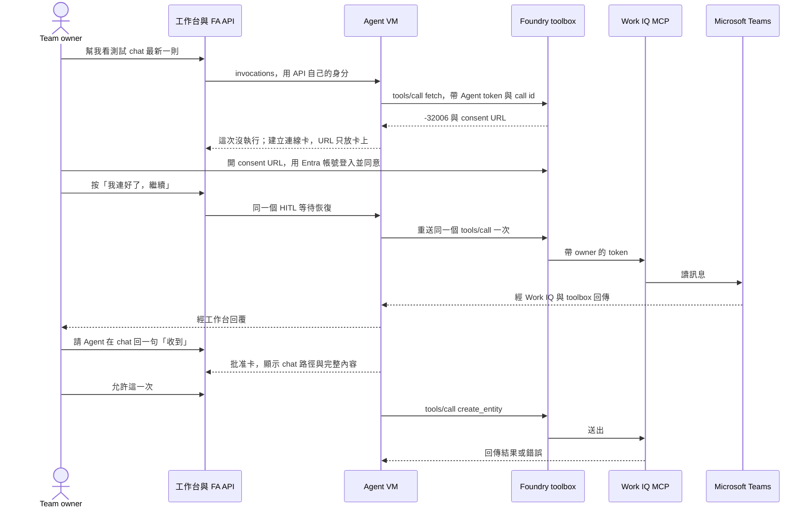

# FA Agent connector 機制設計提案（第二版）

> Neal 10-08 22:21 已決定方向，23:01 批准 P0b 前提並指定帳號（見下節）。P0 已在 2026-10-10 收斂，結果見「[P0 實測結果](#p0-results-1010)」：app caller 可用 owner 完成的 OAuth，但每個 Agent 要各自同意一次。不是部署批准。研究日期 2026-10-08（台灣時間）。

> 實作狀態（2026-10-10）：C1～C5 已合併並部署到 dev（main `82e02283`，[dev 報告](progress.md#connector-m1-dev-1010)）；資料形狀與本文一致。Teams 真人 OAuth、讀取與送出的 live 驗收待 Neal；stage 未部署。

> 實作交接入口：[connector-implementation-handoff.md](connector-implementation-handoff.md)。它列出 P0 收斂、資料形狀、PR 邊界、驗證、批准與收尾。本文仍是產品方向與研究依據的主要來源。

## 一句話結論

FA 不自己做 connector。第一波 Microsoft Teams 直接用 Foundry 工具目錄裡的 Microsoft Work IQ MCP（`https://workiq.svc.cloud.microsoft/mcp`），放進 Team 的 Foundry toolbox，用 `oauth2` connection 保存 owner 的授權；第二波 GitHub 用 Foundry 代管的 `foundrygithubmcp`。connector 預設 Team 裡每個 Agent 都能用，寫入預設每次問。現在先在 dev 跑 GitHub 探針（P0a），確認 Foundry 把授權綁在誰身上；Teams 探針（P0b）的前提 Neal 已在 23:01 批准，先用獨立的探針 toolbox 準備與做真人基準，P0a 結束後再接上 FA Agent。

## Neal 的決定

Neal 10-08 22:21 回覆前一版的五個問題，原文照錄：

> 「all agree, 除了第一階段，我想換成Teams, GitHub放在second wave，另外，儘量使用Foundry已經有的connector，不要重複造輪子」

第 5 題（開始 dev 探針）他回「yes」。結果如下。

1. connector 預設 Team 裡每個 Agent 都能用，各 Agent 可以關。同意。
2. 寫入預設每次問，owner 可以改成不問。同意。
3. 第二波是 GitHub。Gmail、Drive、Notion 這次沒選。
4. 多 Team 上線前，OAuth connector 只在單一 Team 環境開。同意。
5. dev 探針。批准。
6. 另外兩點。第一波由 GitHub 改成 Microsoft Teams；儘量用 Foundry 已有的 connector，不要重做。

## 原則

本提案只用下面五條取捨，原文照錄。下文每一個 FA 自建的部分，都寫出它補的是哪一個官方缺口。

- 「參考Grokbot…儘可能地使用Foundry Hosted Agent的能力…以"足以防止資料損失、重送、與明顯錯誤"的最小機制為原則…不得套用商業/軍規式的流程…」（Neal）
- 「請以"足以防止資料損失、重送、與明顯錯誤"的最小機制為原則，在完成布署前，不得套用商業/軍規式的流程、指標、證據層級或繁瑣的gate。」（Neal）
- 「不要比 grokbot 嚴格。」（Neal，10-01）
- 「儘量使用Foundry已經有的connector，不要重複造輪子」（Neal，10-08 22:21）
- 「SDK-first。回合、工具循環、session、事件、串流與 runtime 生命週期優先使用固定版本 SDK 的正式能力。新增 FA 自建層前，先用官方文件或版本原始碼指出具體缺口；整合錯誤修在接點，不再包一套 agent loop。」（`AGENTS.md` 第 1 條）

## Grok Bot 怎麼做

下表只收 Grok Bot 官方文件判為「明文」或「部分」的做法。Grok Bot 文件把 connector 叫 plugin，從 Cursor Marketplace 安裝。

| 做法 | 判定 | 來源 |
|---|---|---|
| connector 就是 Marketplace 的 plugin，沒有另一份 Grok Bot 專用清單；admin 只能允許或封鎖 | 明文 | https://docs.x.ai/grok-bot/teams-and-enterprises#connector-policy 、https://docs.x.ai/grok-bot/security-faq |
| 使用者自己按 Add 或照聊天裡的 Connect 卡做，在瀏覽器約 10 分鐘內完成授權 | 明文 | https://docs.x.ai/grok-bot/computer-and-apps#connect-an-app 、https://cursor.com/help/grok-bot/connect-plugins |
| OAuth token 留在 Cursor 的 connector backend，Bot 呼叫工具時拿不到，電腦上也不存 | 明文 | https://docs.x.ai/grok-bot/identity-and-access 、https://docs.x.ai/grok-bot/security |
| 裝好的 connector 屬於帳號，該帳號每個 Bot 都能用；Added 只代表裝好，不代表已登入 | 明文 | https://docs.x.ai/grok-bot/computer-and-apps#connect-an-app |
| Team Bot 的 OAuth 類用「正在說話的人」的帳號，key 類用 Bot 自己的憑證 | 明文 | https://docs.x.ai/grok-bot/team-bots 、https://docs.x.ai/grok-bot/security |
| 批准卡有 Allow once、Always allow、Deny；Auto Review 會審 plugin call；Always allow 會寫成規則 | 明文 | https://docs.x.ai/grok-bot/security#approvals-and-auto-review |
| routine 文件建議把寫入放在批准後面；沒人在場的批准約 10 分鐘後過期，動作不執行 | 明文 | https://docs.x.ai/grok-bot/skills-routines-and-automations 、https://cursor.com/help/grok-bot/how-to |
| 撤銷分兩步，先卸載 plugin，再到來源服務撤銷授權 | 明文 | https://docs.x.ai/grok-bot/approvals-security-and-privacy 、https://docs.x.ai/grok-bot/troubleshooting |
| 有 connector 先用 connector，沒有才用瀏覽器；封鎖 plugin 不會封鎖網站 | 明文 | https://docs.x.ai/grok-bot/computer-and-apps 、https://docs.x.ai/grok-bot/security-faq |

公開文件沒寫的部分，由下一節 Neal 的讀碼研究補上。

## Grok Bot 八題的答案（Neal 10-08 22:17 讀碼研究）

這一節來自 Neal 用 Copilot CLI 唯讀研究 Grok Bot 執行環境原始碼（`host-main.cjs`，版本標記 `3f90dc1`）和桌面 app 程式包（`app.asar`）的結果，報告在 Neal 電腦的 `C:\Users\user\grokbot-plugin-fa-research-20261008.md`。這不是 Grok 官方文件，也不是實機操作測試。標籤照原報告，可信度分已驗證、推測、不確定；證據種類分 CODE_VISIBLE、PROMPT_ONLY、FLAG_GATED、NOT_VISIBLE。

| 題 | Grok 的做法 | 標籤 | 對 FA 的影響 |
|---|---|---|---|
| Q1 工具開關範圍 | 關掉一個工具，帳號下所有個人 Bot 一起關；新 Bot 直接看到已安裝的 plugin。Team Bot 另算 | 已驗證（CODE_VISIBLE 加官方文件） | 支持決定 1。FA 預設全 Agent 可用，另外允許單一 Agent 關掉，比 Grok 多一個選擇，不更嚴 |
| Q2 Connect 卡與接續 | 聊天自動出 Connect 卡；授權完成後 Bot 自動接著做原任務；卡上列不列權限看 connector | 接續已驗證；權限列表不確定 | FA 收不到「授權完成」的通知，所以 P1 在連線卡加「我連好了，繼續」，按下才重送同一個呼叫 |
| Q3 寄信與發訊用哪種卡 | Gmail、Slack 預設出可編輯的 Send draft 卡；明確說「寄給某人」時可能直接寄並經 Auto Review；Calendar 只走 Auto Review | 草稿路由已驗證；放不放行推測（FLAG_GATED、PROMPT_ONLY） | Teams 沒有草稿 API，FA 用既有批准卡在送出前顯示完整內容，作用等於草稿卡。需要實機確認 |
| Q4 routine 的過期與 Always allow | Auto Review 批准卡預設 10 分鐘過期當拒絕，但 routine 用哪種過期政策看不到；過期卡按 Always allow 會存一句自然語言規則，被擋的動作不重跑 | 規則建立已驗證；routine 過期時間不確定（NOT_VISIBLE） | FA 保留 600 秒等待，不從卡片產生自動規則（PR #682 的決定）。這只有在 owner 能於「Agent Team 設定」把寫入改成不問時，才符合「不要比 grokbot 嚴格」，這已在計畫內。需要實機確認 |
| Q5 授權過期或被撤銷 | token 在後端自動續期；失敗後下次呼叫出 Connect 卡，明文禁止改用電腦裡的瀏覽器繞過；Plugins 頁對 needsAuth 顯示 Connect | 已驗證（CODE_VISIBLE） | FA 不存「已連線」旗標，遇到 `-32006` 就出連線卡。connector 需要（重新）授權時，模型不得改用 VM 瀏覽器繞過 |
| Q6 任務中途斷開 | 已送出的呼叫可能已完成，之後的呼叫失敗，下一輪請使用者重連 | 推測 | FA 停用從下一個回合抓能力時生效，接續中的請求直接拒絕（`behavior_native_capture.py:132-133`）；結果不明就回報不明 |
| Q7 多帳號沒指定 | 設計上用選單問，不猜，也不沿用上次 | 推測（PROMPT_ONLY、FLAG_GATED） | 第一波每個 Team 只連 owner 一個帳號，不受影響。需要實機確認 |
| Q8 自訂 Remote MCP | 個人 Bot 能在聊天裡加，可填 URL、header 或 OAuth client；欄位齊全的表單只在 Team Bot | 聊天新增已驗證；個人版表單不確定 | 第一波不開放 owner 自填 OAuth MCP，因為 Work IQ 要 admin 先做 app 註冊；金鑰類 Team MCP 表單照舊 |

## FA 今天有什麼

FA 沒有叫 Connector 的產品物件。外部服務是 capability，分 `mcp-api`、`mcp-hosted`、`mcp-toolbox`、`fa-builtin` 四種（`src/fa-shared-context-poc/shared_context/behavior_capabilities.py:42`）。下面的程式路徑都在 `src/fa-shared-context-poc/shared_context/` 底下。

- Team MCP 已上 stage。owner 在「Agent Team 設定」加 MCP server，定義只存在 Foundry toolbox `fa-team-{team}` 的版本和 `default_version`（`team_mcp_wire.py:66`，PR #682）。每個 server 至少要列一個 `allowed_tools`（`team_mcp_wire.py:104`）。金鑰由 API 寫成 `CustomKeys` connection，每次送新金鑰就換一條新名稱的 connection（`team_mcp.py:80`、`team_mcp.py:244-246`）。最多 8 個 server（`team_mcp_wire.py:26`），最後一個不能停用（`team_mcp.py:412`）。
- Hosted 用 Agent 自己的 managed identity 打 toolbox，並轉送原回合的 call id（`native_toolbox.py:408-415`）。同檔說明寫明 per-user OAuth 沒驗過（`native_toolbox.py:23-25`）。Copilot SDK 內建 MCP 預設關，`on_mcp_auth_request` 一律回 cancelled（`m2_copilot.py:1512`）。
- toolbox 回 `-32006` 時，現在只記錯誤碼，訊息裡的 consent URL 被丟掉（`native_toolbox.py:238-245`）。如果錯誤發生在列工具，整個回合的 bind 失敗（`native_toolbox.py:484`）。
- 批准照 toolbox `require_approval`。`always` 每次出卡，`never` 直接執行（`native_hitl_runtime.py:443`）。卡片等待時間 `FA_NATIVE_HITL_TTL_SECONDS` 預設 600 秒（`native_hitl_wire.py:90`），stage 也設 600（`deploy/stage/stage.json:37`）。
- 每個 Agent 用 `/select` 選能力，只影響新對話，最多 12 項（`behavior_capabilities.py:28`）。Team MCP 加好後，owner 還要到每個 Agent 再勾一次。
- API 叫 Hosted 時用 API 自己的憑證（`behavior_foundry.py:338-344`）。從 Foundry 看，每個回合的 caller 都是 API，排程回合也一樣。
- stage 是單一 Team 模式（`deploy/stage/stage.json:110-111`）。toolbox 沒有 Team 層的存取控制（`docs/adr/0007-foundry-hosted-native-first.md:229`）。ADR-0006 A3 把 OAuth connector 列為「之後逐項送 Neal」（`docs/adr/0006-team-trust-boundary-grokbot-mode.md:190`）。
- `src/fa-shared-context-poc` 裡沒有任何 per-user OAuth 連線、refresh 或撤銷的程式。

## Foundry 已有什麼、FA 要補什麼

「沒有 preview 標示」只表示已讀頁面沒有 banner，不等於合約上 GA。

| 能力 | 狀態 | 對 FA 的意義 | 來源 |
|---|---|---|---|
| toolbox 的 `oauth2` connection，Foundry 保存並 refresh 使用者的 token，原文「Foundry isolates tokens per caller automatically.」 | 沒有 preview 標示 | 本提案主線 | https://learn.microsoft.com/en-us/azure/foundry/agents/how-to/tools/tool-authentication |
| `oauth2` 的下游身分是「The user who completes OAuth authorization」 | 同上 | caller 是 app 時怎麼綁沒寫，是最大的未知 | 同上 |
| per-user 解析要轉送 `x-agent-foundry-call-id`，原文「The agent's credential alone isn't enough for per-user resolution.」 | 同上 | FA 已轉送 | 同上 |
| OBO 要收到 user token，原文「They must receive a user token from a client application」 | 本頁未標 | API managed identity 是 app caller，走不了 OBO | https://learn.microsoft.com/en-us/entra/agent-id/agent-on-behalf-of-oauth-flow 、https://learn.microsoft.com/en-us/azure/foundry/agents/concepts/agent-identity |
| Work IQ MCP 可從 portal 工具目錄加進 toolbox，用 delegated Entra，原文「Application-only authentication isn't supported.」 | Foundry 整合是 preview | 第一波 | https://learn.microsoft.com/en-us/microsoft-365/copilot/extensibility/work-iq/mcp/quickstart/foundry 、https://learn.microsoft.com/en-us/azure/foundry/agents/how-to/tools/work-iq |
| managed OAuth 名單有 `foundrygithubmcp`，沒有 Teams、Graph 或 Work IQ | 只有 .NET SDK 標 preview | 第二波 GitHub；Teams 要自備 Entra app | https://learn.microsoft.com/en-us/azure/foundry/agents/how-to/tools/model-context-protocol |
| 使用者未同意時 toolbox 回 `-32006` 和 consent URL；官方要 runtime「Return the consent request to the signed-in user and resume the call after consent.」 | 同上 | 連線卡的來源 | 同上、https://learn.microsoft.com/en-us/azure/foundry/agents/how-to/tools/use-toolbox-hosted-agent |
| `require_approval` 只有 server 層，toolbox endpoint 不擋 `tools/call` | 本頁未標 | 讀寫分開批准要兩個 entry，由 FA 擋 | https://learn.microsoft.com/en-us/azure/foundry/agents/how-to/tools/use-toolbox-hosted-agent |
| portal 有工具目錄；私有目錄經 Azure API Center | 私有目錄 preview | 沒有列出全部目錄 connector 的公開 API | https://learn.microsoft.com/en-us/azure/foundry/agents/how-to/private-tool-catalog |
| Logic Apps connector tool 精靈只支援不用 OAuth 2.0 的 connector | preview | Teams connector 不能走這個精靈 | https://learn.microsoft.com/en-us/azure/logic-apps/add-agent-tools-connector-actions |

官方沒有、FA 要自己補的只有下面六樣：

1. 連線卡。平台只回 `-32006`，不會把 URL 送到工作台。
2. 批准。endpoint 不擋 `tools/call`，`always` 要 runtime 自己擋。FA 已做。
3. toolbox client。官方 `FoundryToolbox` 只有 Agent Framework 的 Python 與 .NET。FA 的 `native_toolbox.py` 已是這一層。
4. Team。toolbox 和 connection 都在 project 層，沒有 Team。FA 用 Team 命名的 connection 和 toolbox 分開。
5. 撤銷。官方沒有刪除單一使用者 token 的方法（tool-authentication 頁）。FA 只能附上服務端的撤銷入口。
6. 讀寫分類。Foundry 不分工具讀寫，FA 用一份很小的參考資料記哪些工具算寫入。

## 第一波 Teams 走 Work IQ MCP

Microsoft 官方建議新開發用 Work IQ API（https://learn.microsoft.com/en-us/microsoft-365/copilot/extensibility/work-iq/api-overview ），它是第一方 remote MCP，Foundry 有加進 toolbox 的正式步驟（quickstart/foundry 頁）。FA 因此不寫 Teams connector，也不出貨 Teams 操作清單。Teams 上能做什麼，由 Work IQ 的 `search_paths` 與 `get_schema` 在執行時找（https://learn.microsoft.com/en-us/microsoft-365/copilot/extensibility/work-iq/mcp/tool-reference ）。

舊的 `mcp_TeamsServer` 官方標為只供相容，原文「shouldn't be used in production environments or new projects」（https://learn.microsoft.com/en-us/microsoft-copilot-studio/mcp-teams-tools ），它還要 Microsoft 365 Copilot 授權和 Frontier 租戶（https://learn.microsoft.com/en-us/microsoft-agent-365/tooling-servers-overview ）。FA 只把它當短期測試的備案。

Work IQ 是通用工具，不限 Teams。FA 分讀寫如下，兩個 toolbox entry 指向同一條 connection。

| entry | 工具 | `require_approval` 預設 |
|---|---|---|
| `teams_read` | `fetch`、`fetch_blob`、`search_paths`、`get_schema`、`list_agents` | `never` |
| `teams_write` | `create_entity`、`update_entity`、`delete_entity`、`do_action`、`call_function`、`ask` | `always` |

`ask` 算寫入，因為它把工作交給另一個 Work IQ agent，對方可能採取動作，研究建議不要自動批准它。overview 頁說有 10 個工具，tool-reference 頁另列 `fetch_blob`，所以實際有哪些工具以 `tools/list` 為準（https://learn.microsoft.com/en-us/microsoft-365/copilot/extensibility/work-iq/mcp/overview ）。兩個 label 都符合 `^[A-Za-z][A-Za-z0-9_]{0,20}$`（`team_mcp_wire.py:30`）。

Work IQ 的租戶政策預設擋下所有寫入，admin 可以打開（https://learn.microsoft.com/en-us/microsoft-365/copilot/extensibility/work-iq/mcp/policy-governance-mcp ）。這是整個租戶的開關，不是每次送出的批准，所以 FA 的批准卡照樣要出。另外要注意，讀取 entry 能讀的不只 Teams。預設允許的路徑前綴是 `/me/`、`/users/`、`/sites/`，連信件和檔案都在內（tool-reference 頁）。owner 連上 Teams，實際上是讓 Agent 讀他的 Microsoft 365 資料。

送 Teams 訊息有三件事要守。

- Teams 沒有草稿 API。Graph 的 chat 和 channel POST 成功就回 `201 Created`（https://learn.microsoft.com/en-us/graph/api/chat-post-messages?view=graph-rest-1.0 、https://learn.microsoft.com/en-us/graph/api/channel-post-messages?view=graph-rest-1.0 ）。tool-reference 頁的 `"isDraft": true` 範例是 Outlook 郵件，不是 Teams。所以 FA 在呼叫前用既有批准卡顯示 chat 或 channel 的路徑和完整內容，只有「允許這一次」和「拒絕」。路徑裡只有 ID，卡上要不要多顯示 chat 名稱，看 P0b 的實際路徑再定（推論）。
- 不盲目重送。舊 Teams MCP 明寫 `postMessage`「Not idempotent」，Work IQ 寫「The server doesn't perform automatic retries.」（mcp-teams-tools 頁、tool-reference 頁）。
- 結果不明就回報不明，保留原 call id，不換 id 重送。

授權與費用要分開看。Work IQ API 用 Copilot Credits 計費，原文「Usage is independent of Microsoft 365 Copilot licensing and available through usage-based billing.」（https://learn.microsoft.com/en-us/microsoft-365/copilot/extensibility/work-iq/ ），經 Azure 訂用帳戶隨用隨付（https://learn.microsoft.com/en-us/microsoft-365/copilot/usage-based-billing-overview-copilot-credits ）。已讀頁面沒寫 Work IQ 每次呼叫扣多少 credit。只作量級參考，Copilot Retrieval API 隨用隨付是每次呼叫 USD 0.10（https://learn.microsoft.com/microsoft-365/copilot/extensibility/api/ai-services/retrieval/paygo-retrieval ）；照這個量級，P0b 約 30 次呼叫大約 USD 3（推論）。

租戶現況由總協調在 10-08 23:0x 經 Microsoft Graph 唯讀查到。FA 的租戶是 Contoso `00000000`，探針與 owner 帳號依 Neal 23:01 指定，用 admin@contoso.onmicrosoft.com（Global Administrator）。這個帳號有 `MICROSOFT_365_E7`，已含 Teams（`TEAMS1`）、Microsoft 365 Copilot、Agent 365 與 Exchange，所以不必指派 Teams 授權，Copilot 授權的文件差異也不影響探針。Work IQ 的服務主體（appId `00000000-0000-0000-0000-000000000048`）已存在，`WorkIQAgent.Ask` 已有整個租戶的 admin consent，一次性租戶設定大致已完成。租戶裡另有別條線建的「Foundry Lifecycle Work IQ」app，FA 不使用、不修改，另註冊自己的 app。22:2x 版本寫的「Fabrikam、owner@contoso.com 沒有 Teams」查錯了租戶：那次 Graph 查詢用的是 az 預設帳號所在的另一個租戶。

## 資料形狀

connector 分三層。Foundry 目錄說「有哪些可以加」，Team connector 是某個 Team 實際加進去的那份，Agent 收窄清單記哪些 Agent 不用它。

FA 不再出貨 connector 目錄。Foundry 有 portal 工具目錄和經 Azure API Center 的私有目錄（preview），但沒有受支援的公開 API 可以列出所有目錄 connector（private-tool-catalog 頁；研究 Finding 4）。FA 不能爬 portal 的私有 API，所以每個啟用的 connector 只留一份很小的參考資料，記 FA 呼叫時必須知道、Foundry 又不提供的幾項。這是最少的做法，因為 API 建 connection 和 toolbox entry 時要填這些值，而 `require_approval` 只能按 server 設。工具說明和參數一律來自 `tools/list`。

```text
ConnectorRef               # 每個啟用的 connector 一份，隨 API 設定出貨，開發者經 PR 修改
  id             "teams"
  server_url     "https://workiq.svc.cloud.microsoft/mcp"
  auth           {kind: "oauth2", app: "<operator 設定的 Entra app 名稱>"}   # client secret 只在 Foundry connection
  scopes         "api://workiq.svc.cloud.microsoft/WorkIQAgent.Ask offline_access"
  read_tools     ["fetch", "fetch_blob", "search_paths", "get_schema", "list_agents"]
  write_tools    ["create_entity", "update_entity", "delete_entity", "do_action", "call_function", "ask"]
  approval       {read: "never", write: "always"}      # 預設值，owner 可改
  revoke_url     "https://entra.microsoft.com"         # Teams 的撤銷要 admin 做，見「流程」

  # 第二波 GitHub 只改這幾項：server_url "https://api.githubcopilot.com/mcp"，
  #   auth {kind: "oauth2", connector_name: "foundrygithubmcp"}，revoke_url "https://github.com/settings/applications"，
  #   讀寫名單在 P0a 列出工具後再分

TeamConnector              # FA 不存；owner 按「加入」時由 API 寫進 Foundry
  connection     t<hash(project, team)>-teams          # 每個 Team 每個 connector 固定一條
  toolbox        fa-team-{team} 裡兩個 entry，指向同一條 connection
  token          Foundry 保存，owner 完成同意時寫入

AgentNarrowing             # 既有 /select，意思改成「這個 Agent 不用哪些 Team connector」
  agent_id → 關掉的 connector id，預設空，也就是全部可用
```

`read_tools` 和 `write_tools` 是分類，不是目錄。FA 的 Team MCP 每個 entry 都要列 `allowed_tools`（`team_mcp_wire.py:104`），而 Foundry 不分讀寫，這兩個名單是唯一不得不寫在 FA 的東西。`tools/list` 出現兩邊都沒有的新工具時，先不開放，等開發者經 PR 分類。

connection 名稱固定，因為同意範圍是「per tool (connection) name per Foundry project」（https://learn.microsoft.com/en-us/azure/foundry/agents/how-to/mcp-authentication ），換名就要 owner 重新同意。金鑰類 Team MCP 照舊每次換名。

FA 不存 token，也不存「已連線」旗標，因為只有 Foundry 知道 token 還在不在，而 toolbox 每次呼叫都會回答。要留的只有三份既有紀錄，一是連線卡，放在 HITL pending 紀錄裡，600 秒後過期；二是 Agent 收窄清單；三是每個對話的「先不用」紀錄。設定頁顯示「已加入」，和 Grok 的 Added 一樣。consent URL 只放在連線卡上，不給模型，不寫 log。如果 prompt injection 讓模型把連結送出去，別人可以用自己的帳號完成同意，之後 Agent 的寫入就進了別人的帳號（推論）。

## 流程

下圖是第一次連線、讀取和送出。`-32006` 出現在列工具還是呼叫工具，要 P0a 確認；圖畫的是呼叫工具的情況。



連線卡加「我連好了，繼續」按鈕，第一版不再要 owner 重問一次。這樣做安全，因為 `-32006` 代表這次沒執行，重送不會造成第二次動作。按鈕沿用現有 HITL 等待和 600 秒期限；重送後如果還是 `-32006`，就回報「還沒連好」並結束，不再重試。Grok 是授權完成後自動接續（Q2，已驗證），FA 收不到完成通知，只能讓 owner 按一下，這是最接近的做法。connector 需要授權或重新授權時，模型不得改用 VM 裡的瀏覽器繞過，一律出連線卡（Q5，已驗證）。

批准沿用現有機制。`teams_read` 是 `never`，直接執行；`teams_write` 是 `always`，出現既有批准卡，顯示工具名與完整參數。Grok 的 Always allow 在 FA 對應到「Agent Team 設定」把寫入改成不問，因為 PR #682 已決定不從卡片產生自動規則。

排程回合走同一條路。寫入卡等 600 秒，逾時就不執行，和 Grok 約 10 分鐘過期一致。排程回合遇到要連線，也出連線卡；owner 不在就過期，該次排程回報「Teams 需要連線」。排程回合和互動回合的 caller 都是 API，應該拿到同一份 token（推論，P0a 第 8 步確認）。

停用與撤銷分兩步，和 Grok 一樣。owner 先在「Agent Team 設定」按「停用」，API 建一個不含這兩個 entry 的新 toolbox 版本並設為預設，不刪任何資源。Teams 的撤銷不像 GitHub 有個人設定頁，要 admin 到 Entra 管理中心撤銷這個 app 的權限，或讓該使用者的 refresh token 失效（https://learn.microsoft.com/en-us/entra/identity/enterprise-apps/manage-application-permissions ）。撤銷 admin consent 會影響整個租戶。有兩件事不知道。沒在服務端撤銷就重新啟用同一條 connection，可能直接沿用舊 token（推論）。`TEAM_MCP_LAST_SERVER` 會擋下停用最後一個 server（`team_mcp.py:412`），P1 要處理。

沒有 connector 的服務，Agent 用自己 VM 裡的瀏覽器登入（SP-11）。遇到密碼、兩步驗證或付款，照現有規則請真人接手。

## 方案比較

| 方案 | token 在哪 | 官方狀態 | 主要問題 | 看法 |
|---|---|---|---|---|
| Work IQ MCP 加 toolbox `oauth2` | Foundry | Foundry 整合 preview | app caller 怎麼綁 owner 未知；要 Teams 授權、計費、租戶設定 | 推薦，P0a、P0b 通過就做 |
| 舊 `mcp_TeamsServer` | Foundry | preview，官方標 legacy | 不該用在新專案；要 Copilot 授權和 Frontier | 只當短期測試備案 |
| Logic Apps workflow 重用 Teams connector，經 Foundry OpenAPI 加進 toolbox | Logic Apps connection | 元件各自有文件，組合未證實 | 多一個 Azure 資源；送出者要選 User 並讀回核對（https://learn.microsoft.com/en-us/connectors/teams/ 、https://learn.microsoft.com/en-us/azure/logic-apps/logic-apps-http-endpoint ） | 正式使用的備案 |
| Graph 經 OpenAPI 加 `oauth2` | Foundry | Graph v1.0 stable；OpenAPI `oauth2` 有文件（https://learn.microsoft.com/en-us/azure/foundry/agents/how-to/tools/openapi ） | FA 要自己寫 spec、管 `Chat.Read`、`ChatMessage.Send` 等 scope | 不做，FA 要接的線比 Work IQ 多 |
| API 自建 OAuth broker，token 放 Key Vault | FA 的 Key Vault | 不適用 | 自己做隔離、同意、refresh，正是要避免的重做 | 不做 |
| Copilot SDK remote MCP 帶靜態 header | VM 行程裡 | SDK 1.0.13 只有 `headers`（https://github.com/github/copilot-sdk/blob/v1.0.13/docs/features/mcp.md ） | token 進 VM，違反 ADR-0006 | 不做 |
| Agent VM 的瀏覽器登入 | 該 Agent VM 的 cookie | 已有（SP-11） | 網站會擋自動化、session 會過期 | 只給沒有 connector 的服務 |

我推薦 Work IQ MCP。它是 Microsoft 給新開發的路，Foundry 目錄裡就有，token 不在 FA、不在 VM、也不在模型裡，FA 新增的只有連線卡、讀寫分類和固定的 connection 名稱。

## 要先用 dev 探針確認的事

最大的未知是身分。OBO 要 user token，FA 的 caller 永遠是 API 的 managed identity，是 app caller（agent-on-behalf-of-oauth-flow 頁）。`oauth2` 的下游身分是「完成 OAuth 授權的人」，但沒有文件說 caller 是 app 時怎麼綁（tool-authentication 頁）。探針分兩段。

### P0a，GitHub 機制探針

Neal 10-08 22:21 已批准，現在在 dev 跑。用 GitHub 是因為它和 Teams 走同一個 Foundry `oauth2` connection 機制，而且不需要授權、計費或 app 註冊的變更。差別只在 OAuth app 由 Foundry 代管或自備（推論）。

1. 本機加一個只給探針用的 dev 旗標。toolbox 回 `-32006` 時，把 consent URL 放進工具失敗文字，讓它出現在聊天裡；不寫 log。探針結束就關掉旗標，正式版不這樣做。
2. 在 dev 用 `azd ai connection create --kind remote-tool --target https://api.githubcopilot.com/mcp --auth-type oauth2 --connector-name foundrygithubmcp` 建一條 connection，再用 ARM GET（FA 現用的 `api-version=2025-06-01`）讀回，記下 FA 之後要寫的欄位。
3. 在 dev 的 Team MCP 設定頁加兩個 server，都指向這條 connection。`ghprobe_a` 只開 `get_me`、不用批准；`ghprobe_b` 只開 `search_repositories`、每次批准。同一個 toolbox 保留一個既有的金鑰類 server。先確認 dev 的 Team MCP 旗標有開。
4. 把探針版部署到 dev。Agent A 開新對話問「我的 GitHub 帳號名稱是什麼」。記下 `-32006` 出現在哪一步，以及金鑰類 server 的工具還在不在。
5. Neal 用自己的 GitHub 帳號開 consent URL。記下要不要先登 Entra、登哪個帳號、能不能完成，以及同意畫面列的權限。
6. Agent A 再問一次，看是否回 Neal 的 GitHub 帳號名稱。
7. 同 Team 的 Agent B 也選這兩個 server，問同一題，看要不要重新同意。再讓 B 用 `ghprobe_b`，看批准卡會不會出現。
8. 用 dev 已開的排程讓 Agent A 跑一次同一題，看排程回合能不能直接用。
9. 基準比較。在總協調的電腦用 Neal 自己的 Entra user token（scope `https://ai.azure.com/.default`）直接打 dev toolbox 的 MCP endpoint，呼叫 `get_me`，看是否要另外同意、回的是不是同一個 GitHub 帳號。這是 user caller，可以和第 4 到 8 步的 app caller 比較。Neal 若在 dev project 沒有 Foundry 角色，加角色是雲端權限變更，要另外批准。
10. Neal 到 https://github.com/settings/applications 撤銷授權，Agent A 再問一次，記下錯誤。最後停用兩個 probe server，connection 依 FA 不刪資源的規則保留。

| 觀察 | 結論 |
|---|---|
| 第 5 步能完成，第 6、7 步都不用再同意 | app caller 可用，一個 Team 同意一次就夠。照本提案做 |
| 第 5 步能完成，第 7 步要再同意 | 授權跟著 Agent。還是能做，但 owner 每個 Agent 都要連一次 |
| 第 6 步仍要再同意，或第 5 步做不到 | 授權無法經 app caller 綁到 owner。Teams 第一波要讓工作台使用者的 token 進到 Foundry（user caller），這會改 ADR-0006 的呼叫方式，要另寫設計並由 Neal 決定，本文不設計 |
| 第 9 步和 app caller 共用同一次同意 | 授權跟著完成同意的人，不跟 caller。多 Team 前要再確認隔離 |
| 第 9 步要另外同意 | user caller 和 app caller 各自一份。單一 Team 可用，多 Team 前仍需每 Team 一條 connection 或一個 project |
| `-32006` 讓整個 toolbox 列不出工具 | 每個 OAuth connector 各用一個 toolbox `fa-connector-{team}-{id}` |
| 第 8 步失敗 | 排程回合先不開 OAuth connector，互動回合照做 |

跨 Team 的風險照前一版。依現有 RBAC，Team A 的 Agent 用自己的 token 就能打 Team B 的 toolbox URL（`docs/adr/0006-team-trust-boundary-grokbot-mode.md:49`、`docs/adr/0007-foundry-hosted-native-first.md:229`；推論，未實測）。單一 Team 的 stage 沒有這個風險，所以決定 4 先只在單一 Team 環境開。

### P0b，Teams 與 Work IQ 探針

前提已在 10-08 23:01 批准（見下一節）。準備工作與真人基準先在獨立的探針 toolbox `fa-probe-workiq` 做，不碰 P0a 正在用的 `fa-team-*` toolbox；P0a 顯示 app caller 可用之後才接上 FA Agent。只在 dev，只用 Neal 指定的測試 chat 和測試 channel。

1. 在 dev 建 Work IQ 的 `oauth2` connection（自備 Entra app），在 Team MCP 加 `teams_read` 和 `teams_write` 兩個 entry。記下 `tools/list` 實際回的工具，和參考資料的分類比對。
2. Agent A 讀測試 chat 最新一則。出現連線卡時 Neal 用 admin@contoso.onmicrosoft.com 同意，按「我連好了，繼續」，核對讀到的是事先約定的內容。
3. Agent A 讀測試 channel 一則。租戶政策若擋 `/teams/` 路徑，記下來，不宣稱 channel 可用。
4. admin 依批准項目 4 打開 Teams 寫入政策。Agent A 送一則固定內容到測試 chat，批准卡顯示路徑和全文，Neal 按「允許這一次」。讀回訊息，核對 `from.user` 是 Neal。結果不明就回報不明，不重送。
5. 再要求送一次，Neal 按「拒絕」，核對測試 chat 沒有新訊息。
6. 若 Neal 要，admin 關回寫入政策。

第二位使用者的隔離測試，只有在已有另一位具 Teams 授權的測試使用者時才做，否則標「未執行」。探針帳號已有 Copilot 授權，所以授權文件的差異不會擋住第 2 步。

<a id="p0-results-1010"></a>
## P0 實測結果（2026-10-09～10，dev）

環境是 dev main `7e9d03fd`（#746 修正探針截斷連結），API revision `ca-fa-behavior-poc--7e9d-v133-1010`。真人同意都由 Neal 本人完成，Entra 用 admin@contoso，GitHub 用 Neal 的帳號。consent URL、token 與讀到的原始內容只留在本機私有檔。

### P0a，GitHub

| 步驟 | caller | 結果 | 證據 |
|---|---|---|---|
| 同意前列工具 | user 與 Agent A | `tools/list` 回 `-32006 CONSENT_REQUIRED`，同一 toolbox 的金鑰類來源成功，但整份列表失敗 | 10-08 基準與 10-10 重測一致 |
| user caller 同意後 | admin@contoso 直打 toolbox | PASS，`get_me` 回 `contoso-owner` | 10-10 00:35 |
| 同一份同意給 Agent A 用 | Agent A | 不能用。A 在新的 MCP session 仍回 `CONSENT_REQUIRED` | 連結裡的 `LogConnectionId` 不同（user `7b7c8f83…`，A `9becd257…`） |
| Agent A 用自己的連結同意後 | Agent A | **PASS**，新對話實際呼叫 `get_me` 回 `contoso-owner` | 10-10 01:27 |
| Agent B | Agent B | 要再同意一次（`7adfeb75…`）。同意後 PASS | 10-10 09:14 |
| B 呼叫 `ghprobe_b`（`require_approval=always`） | Agent B | 批准卡出現；Neal 拒絕後工具沒執行，回覆「工具呼叫被真人拒絕」 | 10-10 09:15 |
| 排程回合 | API 時鐘觸發 A | **PASS**，09:30 排程回合實際呼叫 `get_me` 回 `contoso-owner`；排程之後已停用 | 10-10 09:30 |
| GitHub 撤銷後 | user 與 Agent A | 不是 `-32006`。user 回 `-32007 INVALID_CONFIGURATION`、`get_me` 回 `-32602`「Failed to extract exchanged token from ConnectorGateway response」，沒有 consent URL；A 收到 `NATIVE_TOOLBOX_READ_FAILED` | 10-10 09:57～09:59 |

GitHub 端的授權入口是 Authorized **GitHub Apps** 分頁的「Microsoft Foundry Agent Service」（Owned by Azure），不是 OAuth Apps 分頁。

### P0b，Work IQ

| 步驟 | 結果 |
|---|---|
| user caller 同意（admin@contoso） | PASS，`tools/list` 列出 11 個工具，名稱和本文讀寫分類一致，沒有名單外工具 |
| 工具註記 | `call_function` 伺服器標 `readOnlyHint=true`，本文仍列為寫入，因為它呼叫任意函式 URL |
| 第一次讀取 | BLOCKED：「The caller tenant does not have a billing policy configured for WorkIQ.」 |
| 開計費（Neal 操作，dev 訂用帳戶隨用隨付，只含 Work IQ API，範圍限一個只含 admin@contoso 的私人群組，每月與每人各 2,000 點） | 建立後約 11 分鐘生效 |
| 讀指定 chat 最新一則 | PASS |
| 讀指定 channel 一則 | PASS，`/teams/` 路徑沒被擋 |
| 寫入 | NOT_RUN。`search_paths` 對 chat 路徑只列 `fetch`，符合租戶寫入政策預設關閉；寫入留到 C5 |
| app caller 讀 Work IQ | NOT_RUN。Neal 10-10 同意留到 C5，用獨立 Teams toolbox 實測；機制推論與 GitHub 相同 |

### 判讀與對後續的影響

- **P0 通過。** app caller 可以使用 Team 主人完成的 OAuth，排程回合也可以。不需要另做 user-caller delegation。
- **授權跟著 Agent，不跟 Team。** 依上方判讀表第二列，owner 每個 Agent 都要連一次。C2 的 per-Agent 設計不變；C3 的連線卡要說明這是「這位助理」的連線。
- **每個 OAuth connector 用自己的 toolbox。** 未同意的來源會讓整份 `tools/list` 失敗。探針期間共用 toolbox 的 t4 也受影響（推論，未實測），所以這條規則仍然必要。
- **撤銷不會回到同意流程。** C3 要辨認 `-32007`／`-32602` 的 `Failed to extract exchanged token` 錯誤，並找出讓 owner 重新同意的方法。官方沒有刪除單一使用者 token 的 API，這是未解問題。
- **Teams 寫入、第二位使用者與無 Copilot 授權的 owner** 都未測，留到 C5／D1。
- 探針期間在 dev 留下的資源：connection `ghprobe-github`、`fa-dev-workiq`，toolbox `fa-probe-workiq` v1，`fa-team-team-one` 的 v4～v6，Entra app `fa-dev-workiq-connector`（secret 2026-11-07 到期），群組與費用原則 `FA dev Work IQ probe`。依不刪資源的規則全部保留。

## 分階段

P0a，現在，dev。GitHub 機制探針。產出是一段 progress 紀錄和上表的結論，stage 不變。

P0b，dev，已批准、與 P0a 錯開共用設定。Teams 與 Work IQ 探針。產出是讀、送、拒絕三件事的紀錄。

P1，Teams，只在單一 Team 的 stage 開。先在 dev 完整測試，再由 release PR 交 Neal 決定。

- API 的「加入」建固定名稱的 `oauth2` connection 和兩個 toolbox entry；Hosted 遇到 `-32006` 建連線卡，URL 不給模型、不寫 log，列工具遇到 `-32006` 不讓整個回合失敗。
- connector 預設每個 Agent 都能用，`/select` 只能關。一個 connector 佔 Team MCP 8 個名額中的 2 個（`team_mcp_wire.py:26`），P1 決定名額是否以 connector 計算。
- owner 會看到「Agent Team 設定」多一個 Connectors 頁，列出 Teams 和既有的 Team MCP，各有「讀取要不要問」「寫入要不要問」開關和「停用」。新對話第一次用 Teams 時出現連線卡，卡上有「我連好了，繼續」；送訊息前出現批准卡。

P2，GitHub。owner 在 Connectors 頁多看到 GitHub，流程和 Teams 相同，只是用 Foundry 代管的 `foundrygithubmcp`，不需要租戶設定。

## Neal 的批准（10-08 23:01）

Neal 回覆五項前提，原文照錄：「都同意，除了以下這個statement …… 請用 admin@contoso.onmicrosoft.com 這個帳號跟tenant，而不是owner@contoso.com」。他指的那一項是指派 Teams 授權給 owner@contoso.com。結果如下，標「租戶層」的會影響整個租戶。

1. Teams 授權。不需要做。admin@contoso 的 E7 已含 Teams。
2. Work IQ 用量計費。批准。用 Copilot Credits、經 Azure 訂用帳戶隨用隨付，花費政策只涵蓋 admin@contoso（https://learn.microsoft.com/en-us/microsoft-365/copilot/usage-based-billing-copilot-credits-setup ），掛 dev 訂用帳戶 `00000000-...`，上限約等值 USD 20（推論，只為擋住意外迴圈）。只在探針遇到計費錯誤時才開。帳號已有 Copilot 授權，自訂 agent 是否仍走用量計費，官方原文是「It is subject to usage-based billing for custom and third-party agents.」（https://learn.microsoft.com/en-us/microsoft-365/copilot/extensibility/work-iq/ ），以探針實際結果為準。租戶層。
3. 租戶設定與 Entra app 註冊。批准。Work IQ 服務主體與 `WorkIQAgent.Ask` 的租戶 consent 已存在；FA 另註冊一個自己的 app 給 Foundry `oauth2` connection 用，client secret 只放進 Foundry connection（https://learn.microsoft.com/en-us/microsoft-365/copilot/extensibility/work-iq/permissions ）。租戶層。
4. Teams 寫入政策。批准，只在那一則測試送出前打開，送完關回。租戶層。
5. 本人同意。批准。P0a 用 Neal 的 GitHub 帳號，Entra 若要求登入用 admin@contoso；P0b 用 admin@contoso。

## 與總協調指示不同處

1. 參考資料多了 `read_tools` 和 `write_tools`。指示寫工具名一律來自 `tools/list`，但 FA 的 Team MCP 每個 entry 都要列 `allowed_tools`（`team_mcp_wire.py:104`），而批准只能按 entry 設，所以讀寫分類必須寫在 FA。這是 Work IQ 的 11 個通用工具名，不是 Teams 操作清單；`tools/list` 出現新名稱時先不開放。
2. Teams 的撤銷沒有個人設定頁，要 admin 在 Entra 管理中心做，撤銷 admin consent 會影響整個租戶（manage-application-permissions 頁）。`revoke_url` 對 Teams 只能指向 Entra 管理中心。
3. 「Teams connector」實際上讓 Agent 讀 owner 的 Microsoft 365 資料，包括信件和檔案，因為 Work IQ 預設允許 `/me/`、`/users/`、`/sites/`（tool-reference 頁）。Neal 23:01 批准時已知道這點。
4. Copilot 授權的文件不一致。Foundry quickstart 仍寫每位使用者要 Microsoft 365 Copilot，較新的 overview 寫不需要。探針帳號已有 Copilot，所以 P0b 不受影響；P1 若 owner 沒有 Copilot，要再確認。
5. P0a 第 9 步的基準要用 admin@contoso 的 token 打 dev toolbox。這個帳號是部署 dev 用的操作帳號，應已有足夠角色；若被拒，加角色是雲端權限變更，要另外批准。

## 來源

Grok Bot 與 Cursor 官方頁。docs.x.ai 於 2026-10-08 讀取，cursor.com 是 WebIQ 快取，擷取日 2026-10-03 到 10-08。

- https://docs.x.ai/grok-bot/teams-and-enterprises 、https://docs.x.ai/grok-bot/computer-and-apps 、https://docs.x.ai/grok-bot/identity-and-access 、https://docs.x.ai/grok-bot/security 、https://docs.x.ai/grok-bot/team-bots 、https://docs.x.ai/grok-bot/settings-and-notifications
- https://docs.x.ai/grok-bot/skills-routines-and-automations 、https://docs.x.ai/grok-bot/approvals-security-and-privacy 、https://docs.x.ai/grok-bot/troubleshooting 、https://docs.x.ai/grok-bot/security-faq 、https://cursor.com/help/grok-bot/connect-plugins 、https://cursor.com/help/grok-bot/how-to

Grok Bot 讀碼研究。Neal 10-08 22:17 用 Copilot CLI 1.0.80 唯讀研究 `host-main.cjs`（`3f90dc1`）與桌面 app `app.asar`，報告在 `C:\Users\user\grokbot-plugin-fa-research-20261008.md`。不是官方文件，沒有實機操作。

Microsoft、GitHub 官方頁，2026-10-08 讀取。S 編號對應 Teams 研究的來源表。

- Foundry 頁面 https://learn.microsoft.com/en-us/azure/foundry/agents/how-to/tools/tool-authentication （S08）、https://learn.microsoft.com/en-us/azure/foundry/agents/how-to/mcp-authentication （S07）、https://learn.microsoft.com/en-us/azure/foundry/agents/how-to/tools/model-context-protocol （S12）、https://learn.microsoft.com/en-us/azure/foundry/agents/how-to/tools/toolbox （S32）、https://learn.microsoft.com/en-us/azure/foundry/agents/how-to/tools/use-toolbox-hosted-agent （S09）、https://learn.microsoft.com/en-us/azure/foundry/agents/how-to/tools/work-iq （S02）、https://learn.microsoft.com/en-us/azure/foundry/agents/how-to/tools/openapi （S17）、https://learn.microsoft.com/en-us/azure/foundry/agents/how-to/private-tool-catalog （S33）、https://learn.microsoft.com/en-us/azure/foundry/agents/concepts/agent-identity （S11）
- Work IQ 頁面 https://learn.microsoft.com/en-us/microsoft-365/copilot/extensibility/work-iq/ （S01）、https://learn.microsoft.com/en-us/microsoft-365/copilot/extensibility/work-iq/mcp/overview （S04）、https://learn.microsoft.com/en-us/microsoft-365/copilot/extensibility/work-iq/mcp/tool-reference （S05）、https://learn.microsoft.com/en-us/microsoft-365/copilot/extensibility/work-iq/mcp/policy-governance-mcp （S06）、https://learn.microsoft.com/en-us/microsoft-365/copilot/extensibility/work-iq/mcp/quickstart/foundry （S15）、https://learn.microsoft.com/en-us/microsoft-365/copilot/extensibility/work-iq/api-overview （S16）、https://learn.microsoft.com/en-us/microsoft-365/copilot/extensibility/work-iq/enable-work-iq （S39）、https://learn.microsoft.com/en-us/microsoft-365/copilot/extensibility/work-iq/permissions （S41）
- 計費頁面 https://learn.microsoft.com/en-us/microsoft-365/copilot/usage-based-billing-overview-copilot-credits （S37）、https://learn.microsoft.com/en-us/microsoft-365/copilot/usage-based-billing-copilot-credits-setup （S38）、https://learn.microsoft.com/microsoft-365/copilot/extensibility/api/ai-services/retrieval/paygo-retrieval
- Teams 與 Agent 365 頁面 https://learn.microsoft.com/en-us/microsoft-copilot-studio/mcp-teams-tools （S13）、https://learn.microsoft.com/en-us/microsoft-agent-365/tooling-servers-overview （S03）、https://learn.microsoft.com/en-us/connectors/teams/ （S22）、https://learn.microsoft.com/en-us/graph/api/chat-post-messages?view=graph-rest-1.0 （S18）、https://learn.microsoft.com/en-us/graph/api/channel-post-messages?view=graph-rest-1.0 （S19）
- Logic Apps 頁面 https://learn.microsoft.com/en-us/azure/logic-apps/add-agent-tools-connector-actions （S27）、https://learn.microsoft.com/en-us/azure/logic-apps/logic-apps-http-endpoint （S40）
- Entra 頁面 https://learn.microsoft.com/en-us/entra/agent-id/agent-on-behalf-of-oauth-flow （S25）、https://learn.microsoft.com/en-us/entra/identity/enterprise-apps/manage-application-permissions
- GitHub 頁面 https://github.com/github/copilot-sdk/blob/v1.0.13/docs/features/mcp.md 、https://github.com/github/github-mcp-server 、https://github.com/settings/applications

Repo 行號以 main `d7ab7822`（2026-10-08）為準；它和前一版引用的 `b808533c` 相比，`src`、`deploy`、`docs/adr` 與 `AGENTS.md` 沒有變動。
