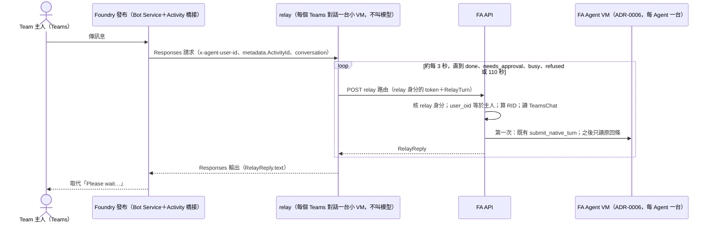

# 在 Microsoft Teams 和 FA Agent 對話：設計

> 狀態：**設計，主線是 N2**。Neal 2026-10-10 決定「先不改 ADR-0006，以 N2 為主，N1 當比較組」，並說「Teams Bot 這部分可以繼續往下走」。本文不是部署、雲端寫入、租戶設定或 Git 發布的批准。修訂日期 2026-10-10（台灣時間），repo 基準 `origin/main` `a5672bfb`。
>
> 範圍：使用者在 Teams 裡直接和自己的 FA Agent 聊天，Teams 是**對話入口**，和工作台並存。這和 [connector 設計](connector-design.md) 不同；那份是 Agent 把 Teams 當工具（Work IQ MCP）去讀寫訊息。
>
> 標示：**已實測**＝10-10 在 dev 用 echo 探針親眼看到；**官方文件**＝Microsoft 或 xAI 的官方頁；**推論**＝由前兩者推出，還沒實測。

## 一句話結論

用 Foundry 官方的「發布到 Teams」，但發布的不是 FA Agent 本身，而是一個很小的轉送 agent（下稱 relay）。relay 收到每則 Teams 訊息後，用自己的身分呼叫 FA API；FA API 核對發話人是 Team 主人、用 Teams 的 `ActivityId` 算出 RID 去重，照 ADR-0006 在那個 FA Agent 自己的 VM 上跑回合，再把最後的回覆文字交回 relay，由平台送回 Teams。

為什麼選它：bot 資源、Teams app、第一次登入卡和長回合的「Please wait…」都由平台處理，每個 Agent 上線只要一鍵發布，FA 只多維護一個不叫模型的小 image 和一條 API 路由；ADR-0006 的入口核對、去重、每 Agent 一台 VM、用量入帳全都不變（推論，依下面的實測）。自建 Azure Bot 指向 FA API（上一版推薦的路徑 b）改成備案：只有客戶堅持所有入站都經自己的 Front Door／WAF，或一定要串流、主動送訊時才用。

echo 探針證明了（已實測 10-10）：官方發布路徑在 dev 能用；容器每則訊息都拿得到發話人的 Entra oid（header `x-agent-user-id`）和每則唯一的 `metadata.ActivityId`；長到 120 秒的回覆也送得到，而且每則訊息只進容器一次。它也證明了兩個限制：容器拿不到任何使用者 token，而且平台是「每個 Teams 對話一台 VM」，不是每個 Agent 一台。這兩點就是 N1 不能直接用、N2 要經 FA API 的原因。

## 原則

本設計只用下面的取捨，原文照錄。FA 自建的每一塊都寫出它補的是哪個官方缺口。

- 「請以"足以防止資料損失、重送、與明顯錯誤"的最小機制為原則，在完成布署前，不得套用商業/軍規式的流程、指標、證據層級或繁瑣的gate。」（Neal）
- 「不要比 grokbot 嚴格。」（Neal，10-01）
- SDK-first／Hosted 原生優先（`AGENTS.md` 第 1 條、ADR-0006 實作原則）。

Neal 10-10 已決定、本文照做的事：

- 主線 N2，N1 只當比較組；ADR-0006 不改。
- 上線摩擦要低、維護要少，優先用官方原生支援。
- 批准照 Grok：真人互動回合的批准一直等使用者（PR #751、#753 已實作，內部上限 24 小時）；背景回合 600 秒。
- 接受 relay 這條信任邊（10-10，原文「同意，照預設接受」）：FA API 信任設定裡的 relay agent 身分轉來的平台 `x-agent-user-id`（Entra oid），再由 FA API 比對它等於 Team 主人的 oid。細節見「信任：多出來的一條邊」。

## 三個做法比較

| 項目 | N1：官方發布 FA Agent 本身 | **N2：官方發布 relay（主線）** | 自建 Azure Bot → FA API（備案） |
|---|---|---|---|
| 誰跑回合 | 被發布的 agent，每個 Teams 對話一台 VM（已實測） | FA Agent 自己的 VM，經 FA API（推論，T2 實測）；relay 每個 Teams 對話一台小 VM，不叫模型 | FA Agent 自己的 VM，經 FA API |
| 和 ADR-0006 | 不合：繞過入口核對、去重、每 Agent 一台 VM、交付與入帳 | 合；多一條信任邊（見「信任」） | 合 |
| 上線步驟 | 一鍵發布 | 每個 Agent 一鍵發布一個 relay；使用者第一次點一次登入卡 | 建 Bot、寫 manifest、上傳 Teams app、設 messaging endpoint |
| FA 要維護 | 在 VM 裡重做主人核對、去重、入帳，等於第二套入口 | 一個小 image＋一條 API 路由＋一張對照列 | Teams 通道程式、簽章驗證、對話位址表、交付紀錄、主動送訊、批准卡 |
| 客戶 VNet | 入口在 Foundry 公開邊緣，只放 Microsoft 來源 IP | 同 N1 | 入口在 FA API，可經客戶 Front Door＋WAF＋Private Link |
| 去重鍵 | `metadata.ActivityId`，要自己做 | RID＝hash(relay 身分, `ActivityId`)，沿用 Hosted `rid:<RID>` | RID＝hash(bot, conversation, `activity.id`) |
| 發話人身分 | `x-agent-user-id`＝oid（已實測），沒有 token | 同 N1，由 FA API 比對 Team 主人 | Bot Connector 簽章裡的 `from.aadObjectId`（官方文件） |
| 長回合 | 平台顯示「Please wait…」，120 秒已實測 | 同 N1；超過 relay 的等待上限改回固定文字 | 先回 200，回合結束後主動送一則（官方文件） |
| 串流、卡片 | 不支援串流與 citation（官方文件） | 同 N1 | Teams 串流與 Adaptive Card 都能用（官方文件） |

N1 的比較資料就是 echo 探針本身（它就是被直接發布的 agent），不另外把 FA Agent 直接發布。

## echo 探針量到什麼

探針是一次性的 Hosted agent，只實作 Responses、從不叫模型，回報的 id 都只寫 sha256 前 12 碼。程式未進 repo，放在 `connector-p0-recon` worktree 的 `probes/teams-publish-echo/main.py`（`azure-ai-agentserver-responses==2.2.0`、`azure-ai-agentserver-core==2.2.0`）。以下全部是 2026-10-10 在 dev（`cog-fasample-memory-demo`／`faexample`）**已實測**。

| # | 量到的事 |
|---|---|
| 1 | 探針 #1 `teams-publish-echo`：照官方 REST 文件自己建 bot（`msaAppId`＝agent 的 `instance_identity.client_id`、SingleTenant、endpoint `https://<acct>.services.ai.azure.com/api/projects/<proj>/agents/<agent>/endpoint/protocols/activityProtocol`、開 Teams 頻道），再用 Microsoft 365 publish API 以 `publishScope: Shared` 發布。Teams 訊息全部被默默丟掉：沒建 Hosted session、沒有容器 log、App Insights 沒有 request；Bot Service 的 Teams 頻道只有早上兩筆「There was an error sending this message to your bot.」，之後的訊息什麼都沒有。 |
| 2 | 探針 #2 `teams-publish-echo2`（同一個 image）用 Foundry 入口網站一鍵發布（「Just you」）。Foundry 自動建了 bot `teams-publish-echo-example`（S1、SingleTenant、app id 一樣是 agent 的 instance identity），endpoint 是 `.../agents/teams-publish-echo2/endpoint/protocols/activityprotocol?api-version=2025-11-15-preview`。其他 bot 屬性和 #1 相同（沒有 OAuth connection 設定、同 tenant、串流關、schema 1.3）。**#2 能用。** 差別只在 endpoint 有沒有 `api-version`；「少了 `api-version` 造成默默丟訊息」是推論，還沒用改 #1 的方式證明。 |
| 3 | 第一則訊息：平台先顯示「Please wait while I process your request」，接著出「User Sign-in」卡；使用者（admin@contoso）登入一次後，原訊息照常送進容器並得到回覆。 |
| 4 | 同一個 Teams 對話落在同一個 Hosted session（同一台 VM）、同一個 `conversation` id，請求計數 1→2。`/foundry_new_preview` 由平台處理（回「Conversation reset…」，不進容器）；下一則訊息換新 session，也換新 `conversation`。所以官方路徑是**每個 Teams 對話（每個 caller）一台 VM**。 |
| 5 | 每個請求都帶 `x-agent-user-id`，值是發話人的 Entra **object id（oid）**：sha256(oid) 前 12 碼相符；同一個人從 Teams 和直接打 API 得到同一個值。沒有 `x-ms-user-identity`。容器收不到 Authorization、token、cookie 類 header，metadata 也沒有像 JWT 的值，所以 relay 沒有 OBO 可用的 token。 |
| 6 | Request body 欄位：`agent_reference`、`background`、`context_management`、`conversation`、`include`、`input`、`metadata`、`model`、`store`、`stream`。metadata 有 `ActivityId`（每則 Teams 訊息都不同，可當 RID／去重鍵）、`ActivityProtocolConversationId`，以及 `x-ms-telemetry-*`。沒有用 `previous_response_id`，用的是 `conversation`。 |
| 7 | 長回覆：`sleep 20`／`60`／`120` 都送到。Teams 顯示「Please wait…」加進度條和 Stop 鍵，最後換成答案。`arrivals` 顯示每則訊息正好一個容器請求（HTTP 200，492 ms／20.4 s／60.4 s／120.4 s），沒有重試或重送。沒有串流。Stop 沒有測。 |
| 8 | 發布後 agent endpoint 的協定是 activity＋responses，`authorization_schemes` 是 Entra＋BotServiceRbac。BotServiceRbac 要求 caller 在 tenant 內、而且對 project 有 Foundry 權限（admin@contoso 有 Foundry User）。 |
| 9 | 留在 dev 的資源（Neal 同意保留，沒有刪）：agent `teams-publish-echo`、`teams-publish-echo2`；bot `teams-publish-echo-example-bot`（F0）、`teams-publish-echo-example`（S1；Teams 是標準頻道，不計訊息費）；兩個只有 admin@contoso 看得到的 Teams app。 |

## N2 設計

### 資料形狀

```text
TeamsRelay                     # 部署設定，每個 FA Agent 一筆，不存 Table
  relay_agent      Foundry 上 relay agent 的名稱
  relay_oid        relay agent 的 instance identity；FA API 只收這個身分的呼叫
  agent_id         這個 relay 接的 FA Agent
                   # Team 和主人 oid 從 Agent 的 Team 登記讀，不另填

RelayTurn                      # relay → FA API；同一則訊息每次內容都一樣，可以重打
  activity_id      body metadata.ActivityId
  chat_id          body conversation（平台的 conversation id）
  user_oid         header x-agent-user-id
  text             這則訊息的文字

RID（不存）  tr-<sha256(relay_oid | chat_id | activity_id)[:40]>   # 43 字元，符合 sc/models.py 的 ID_PATTERN

TeamsChat                      # 一個平台 conversation 一列，只建一次，不改不刪
  key              tc-<sha256(relay_oid | chat_id)[:40]>
  conversation_id  FA 的 CID

TeamsPending                   # 和 TeamsChat 同一個 Team partition，另一列；建立後只用 ETag CAS 改，不刪
  key              tp-<sha256(relay_oid | agent_id | 主人 oid)[:40]>
  pending          最多 8 筆 {rid, to, at}：Teams 還沒拿到回覆的回合（見「補上先前的回覆」）

relay 請求的 header  X-FA-Relay-Ack: 1   # 只在一對一對話；這個 relay 會 ack；/turns、/decisions 沒有它就不記錄、不附加

RelayReply                     # FA API → relay
  state    done | running | needs_approval | busy | refused | failed
  text     顯示在 Teams 的文字；done 是回合最後的回覆，其他是固定文字；最終狀態可附上先前的回覆
  confirm  選填：這段文字帶到的已記錄 RID，relay 收到後 ack

RelayAck                       # relay → FA API，POST /teams-relay/v1/acks
  chat_id、user_oid、request_ids（＝confirm）
```

為什麼這樣最少：

- RID 由對話和 `ActivityId` 算出，同一則訊息不管重打幾次都是同一個 RID（不同對話的同一個 `ActivityId` 是不同回合），不需要新的去重表。唯一的去重仍是既有的 Hosted `rid:<RID>` 建立或讀回（`sc/native_turns.py`，同 RID 不同內容回 409 `NATIVE_RID_CONFLICT`）。
- `TeamsChat` 存在只因為 FA 的 CID 是第一個回合時由平台建立（`sc/behavior_native_responses_api.py` 的 `submit_native_turn`，`conversation_id` 為空時呼叫 `create_conversation`），而平台的 conversation id 不是 FA 的 ID 格式，需要一筆對照。
- 和上一版相比刪掉了 `TeamsDelivery`、Teams 簽章驗證和主動送訊：回覆放在同一個 HTTP 回應裡，由平台送到 Teams，FA 不碰 Teams 的送訊 API，所以沒有「同一則回覆送兩次」的問題。

`chat_id` 選平台的 `conversation` 而不是 `ActivityProtocolConversationId`：使用者打 `/foundry_new_preview` 時平台會換新 conversation（已實測），用它當 key，FA 也跟著開新對話，畫面上說「Conversation reset」而 FA 還接著舊對話的錯位就不會發生（推論）。這是預設，Neal 可改（決定第 4 項）。

### 每則訊息的流程



規則：

1. **relay 只轉送。** 它讀 header 和 metadata、組 `RelayTurn`，用 relay agent 自己的 instance identity 取 FA API 的 token。這和 FA Agent 今天經 API 薄轉送讀寫 Team 資料用的是同一種 agent token（ADR-0006 第 3 節）。relay 不存任何東西、不叫模型、不碰 Teams API。
2. **API 先核 relay 身分。** token 的 oid 不在 `TeamsRelay` 設定裡就回 403，不送回合。
3. **再核主人。** 平台沒帶 `x-agent-user-id` 時 relay 自己回同一句固定文字，不呼叫 API。`user_oid` 缺少或不等於這個 Agent 的 Team 主人 oid：回 `refused`，文字固定「這個助理只回應它的主人。」，不送回合、不記錄。沒有匿名或「預設主人」的退路。
4. **RID 去重。** API 用 `tr-` RID 呼叫既有的 `submit_native_turn`；RID 已存在就只讀原回條，絕不開第二個回合；同一則訊息的兩個請求同時第一次送出時，後到的那個會因為已帶上剛寫的 CID 被 Hosted 回 409，API 改讀原回條回它的狀態。relay 的輪詢、平台可能的重送、relay VM 重啟後重打，都落在同一個 RID。
5. **對話對照。** 有 `TeamsChat` 就帶它的 CID；沒有就以新對話送出，回合被接下後建立 `TeamsChat`（只建一次）。如果在兩者之間當掉，同一則訊息重打時從原回條讀出 CID 補寫；若使用者先傳了另一則新訊息，那則會開另一個 FA 對話。這不掉資料也不重送，舊對話留在工作台（推論，可接受）。
6. **互動回合。** Teams 來的回合算真人互動回合，批准照 #751 一直等使用者。
7. **忙碌。** 同一個 Agent 的回合照既有排他佇列排隊，排著就是 `running`；佇列拒收時回 `busy`，文字固定「Agent 正在忙，請稍後再傳。」，不自動重送。
8. **回覆。** `done` 時 `text` 是回合最後的回覆文字。v1 只收送文字；Teams 傳來的檔案或圖片，relay 回「v1 只收文字」。

### 長回合、批准、停止

- **等待上限（預設，Neal 可改）。** relay 最多等 110 秒（已實測 120 秒仍送得到）。超過時顯示 API 最後一次回的 `running` 文字並結束這次請求：會記錄先前回覆的 API 回「這一輪還在跑；完成後，回覆會附在你下一則訊息的回覆前面，也可以先到工作台看。」，較舊的 API 回「這一輪還在跑，完成後結果在工作台。」（relay 自己不另外承諾）。如果這段時間 API 從沒回過 2xx（一直 5xx 或連不上），或回了 4xx，改回「暫時無法確認助理有沒有收到；請先到工作台查看，再決定要不要重傳。」，不自動重送。回合本身照常跑完。N2 沒有主動送訊，所以結果不會自己出現在 Teams；它會附在下一則訊息的回覆裡（見下一項）。T2 會用 echo 探針量平台真正的上限，再決定要不要拉長。
- **補上先前的回覆（2026-10-14，總協調依 Neal「使用者幾乎感覺不到；不掉、不重送、不拒絕」決定，CODE／offline，未部署）。** 不用新的 Teams API 或憑證，relay 仍不存東西：
  - **只對會 ack 的 relay，只在一對一對話。** relay 只在一對一對話（`metadata.ActivityProtocolConversationId` 以 `a:` 開頭，Microsoft 範例中 Teams 個人對話的格式；群組與頻道是 `19:…@thread…`，其他值或沒有都算不是）的 `/turns` 和 `/decisions` 帶 header `X-FA-Relay-Ack: 1`（用 header 不用 body 欄位：API 的 body 嚴格，舊 API 會拒絕新欄位，但會忽略不認得的 header）。沒有這個 header 時 API 不記錄、不附加，回覆和補上功能之前完全一樣。
  - **記錄。** API 回某個回合 `running`（或等批准、或拒絕後回合仍在跑）時，把它的 RID 記在 `TeamsPending`（依記錄順序，最多 8 筆；滿了丟最舊的一筆，它仍在工作台；上限調低後讀到較長的舊列也一樣只留最新的幾筆，不拒絕；記錄或上次附上已超過 24 小時的也丟掉，它不再算「剛完成」，例如 relay 退回舊版一段時間後再升級時留下的紀錄。退版不到 24 小時又升級時，舊紀錄仍可能以「剛完成」附上一次，這是刻意接受的取捨：寧可多附一次，不掉）。這是和 `TeamsChat` 分開的一列，`TeamsChat` 的內容永遠不變。記錄只用 ETag CAS，不碰回合本身，RID 與原回條照邊界 7 不變。記錄寫不進去時只記 log，這則照常回覆；`running` 時改回「這一輪還在跑，完成後結果在工作台。」，不承諾下一則。
  - **附上。** 主人經同一個 relay 傳的下一則訊息（含「允許／拒絕 代碼」，也含 `/foundry_new_preview` 之後的新對話）回最終狀態時，API 依記錄順序讀這些回合：完成的附上原回覆；`unknown` 附「（這一則沒有完成，請到工作台查看。）」；排隊被拒（`busy_refused`）附「（當時助理在忙，這一則沒有執行；需要的話請再傳一次。）」；還在跑的留著。格式是「先前的回覆（剛完成）：」、每則以「「原訊息前 30 字」」開頭、`——`，最後是這則自己的回覆。這則訊息也逾時（只回 `running`）時什麼都不附，全部留到再下一則。多出來的讀取有上限：`running` 輪詢不多讀；最終回覆（每則訊息一次，回應遺失重打才再一次）最多讀 8 筆紀錄（120 秒內已交給別則的跳過），每筆一次回條讀取，加上已結束的回覆內容或等待中的卡片。
  - **等批准的先前訊息。** 已記錄的回合後來停在批准卡（或提問、Connect 卡）時，每個最終回覆都在「先前的訊息還在等你處理：」下附上它的批准文字（含「允許／拒絕 代碼」）。這段不列入 `confirm`，所以處理之前每次都會出現，處理完、回合結束後再照常附上它的回覆。
  - **順序。** 一般回覆是先前的回覆在前、這則在後。批准指令的結果和要求批准的回覆放最前面，`——` 之後才是先前的回覆，代碼不會被擠到下面；代碼查不到、重複、已處理、過期這類固定回答原樣回，不附任何東西。
  - **長度。** 合計以 UTF-16 計不超過 24,000 bytes（保守預設：Teams 官方公布最低的上限是 incoming webhook 的 28 KB，bot 訊息的上限各處說法不一）。單則太長就截斷並附「……（太長，完整內容在工作台）」；放不下的留到下一則，並加一句「還有更早的回覆，會附在你下一則訊息的回覆裡，也可以到工作台查看。」。
  - **通常只附一次。** 附上的 RID 先以 CAS 標成交給這則訊息，回覆帶 `confirm`；relay 收到最終回覆、交給平台之前打 `POST /teams-relay/v1/acks`，API 才刪掉這些紀錄。交給某則訊息的 RID 120 秒內不會再交給別則（relay 最多等 110 秒），所以兩則訊息同時結束也不會各附一次；同一則訊息因回應遺失重打，拿到同樣內容。
  - **交付未知就保留（刻意的取捨）。** N2 拿不到 Teams 的送達回條，最接近的證明是「relay 已收到這個最終回覆」。ack 沒送到（逾時、5xx、relay 在最後一刻放棄）時紀錄不刪，120 秒後下一則訊息會再附一次：寧可罕見地重複，也不遺失。relay 交給平台之後平台沒送到 Teams 的風險，和今天每一則一般回覆相同。
  - **界線。** 紀錄在這個 Agent 的 Team partition，key 是 relay 身分＋Agent＋主人 oid；只有核對過是主人之後才記錄、附上或清除，別的 relay 或非主人既看不到也清不掉。v1 只有主人和助理的一對一對話（群組與頻道不在 v1），所以跨對話附上只會出現在主人自己的對話裡；程式上 relay 也只在一對一對話帶 ack header，群組或頻道的訊息不記錄也不附上。之後若支援群組，要先改回以對話為範圍。真實個人對話的 `a:` 前綴還沒在 dev 讀回；若不符，只是補上功能不作用、回覆照舊。
  - **新舊版本混用。** 任一邊先部署都可以：新 relay 配舊 API 時舊 API 忽略 header，照舊回覆，逾時文字也是舊 API 自己的；新 API 配舊 relay 時沒有 header，什麼都不記錄。退回舊 API 時 `TeamsChat` 沒變，舊 API 照常讀；`TeamsPending` 只是被忽略。
  - 程式與測試見 [Shared Context README](../src/fa-shared-context-poc/README.md#teams-relay)「補上先前的回覆」。
- **批准（Neal 2026-10-11 核准「方案 B」：在 Teams 用固定文字指令批准，指令不進模型）。** API 看到這個 RID 在等批准時回 `needs_approval`，批准卡的文字對每張開著的卡附一個 6 位代碼（sha256(pending_id) 取十進位後六碼）：「這一步需要你批准（工具名）。允許請回覆「允許 123456」，拒絕請回覆「拒絕 123456」；也可以到工作台處理。」
  - relay 轉成回合前，先用 `^(允許|拒絕)\s+([0-9]{6})$` 全文比對去頭尾空白後的訊息；符合就改打 `POST /teams-relay/v1/decisions`（body：`chat_id`、`activity_id`、`user_oid`、`choice`＝`allow_once`／`deny`、`code`），不符合（含「允許他吧」）照常當一般訊息。
  - API 用和回合路由相同的 relay 身分白名單與主人核對，從 TeamsChat 找出 CID，在該 Agent 的批准卡中以代碼比對（含已決定的卡，所以重送讀得到結果）；卡要屬於這個 CID，或（會 ack 的 relay）屬於 `TeamsPending` 記著的回合，所以附在別的對話裡的代碼在顯示它的地方也能用，`/foundry_new_preview` 後第一則就打代碼也一樣。這段對話沒有 CID、也沒有記著的回合時回「找不到這段對話的待批准項目，請到工作台處理。」；沒有符合「這個代碼沒有對應的待批准項目（可能已處理或過期）。」；多於一張「代碼重複，請到工作台處理。」；剛好一張就以主人身分送既有的 `NativeHitlDecision`。這條路由只收批准，沒有規則變更、提問回答或 Connect 決定。
  - 冪等：同一個選擇再送，讀回已存的決定並回同一個成功結果（工作台的「依規則允許」也算允許）；相反選擇回「這個項目已處理過。」；已過期或回合中斷回「這個項目已過期。」；規則已放行而開始執行（`effect_unknown`）回「這個項目已處理過。」。
  - 每則 Teams 訊息有自己的決定 ID（含 chat_id、activity_id 與當下規則版本），relay 輪詢沿用同一個 ID；輪詢期間主人改了規則時換成新規則版本的 ID，仍只寫同一個選擇；同一個 ID 遇到回應未知只讀原紀錄，不重送。決定寫入時被別的寫入搶先（412 `BEHAVIOR_CONFLICT`，含規則剛換版後的第二次）而卡片仍在等，回「這次沒有送成，請再傳一次同樣的指令。」；Neal 再打一次是新的明確決定，用新的 ID。
  - 成功後回原回合的狀態（`running`／`done`／`failed`，沿用既有文字）；拒絕時回合還在跑就回「已拒絕，這一步沒有執行。」。relay 約每 3 秒重送同一個 body，直到最終狀態或既有的 110 秒上限，沿用既有的「還在跑」／「暫時無法確認」文字，沒有第二套等待規則。
  - 排程（routine）批准卡的允許會先寫排程定義，仍只能到工作台處理。提問「助理有問題要問你，請到工作台回答，結果會在工作台。」與 Connect 卡「需要連線，請到工作台處理，結果會在工作台。」維持只能在工作台。回合照 #751 一直等主人。
  - Adaptive Card 已探測，被平台擋下：2026-10-11 在 dev，只回 activity 的 hosted agent 一直沒進 Running（"Agent ... is not in Running state yet"），所以 v1 不在 Teams 出卡。
- **停止。** v1 不支援。Teams 的 Stop 鍵會不會觸發 relay 的 `cancellation_signal` 還沒測（已實測時沒按）。T2 用 echo 探針 `sleep 60` 按一次 Stop（不花模型錢）；如果會觸發，之後一個小切片把它接到既有的 `/work-policy/v1/responses-turns/cancel`，帶同一個 RID。

### 信任：多出來的一條邊

ADR-0006 第 1 節是「入口確認一次下指令的是團隊主人本人」，今天靠的是工作台送來的真人委派 token。N2 的入口換成：relay 的 agent token，加上平台放在 header 裡的發話人 oid。FA API 自己看不到真人的 token。

為什麼可以接受（推論）：

- `x-agent-user-id` 由平台依登入者的 token 設定；同一個人從 Teams 和直接打 API 得到同一個值（已實測）。官方 runtime contract 說閘道只轉 `x-client-*`、追蹤類和內容協商 header（官方文件），所以呼叫者自己塞的 `x-agent-user-id` 進不了容器。
- relay 的程式是 FA 自己的，image 固定 digest，和 FA Agent 一樣由部署線發布。
- FA API 只收設定裡那個 relay 身分的呼叫，而且一個 relay 只能代表它對應的那一個 Agent。
- 直接呼叫 relay endpoint 的人，`x-agent-user-id` 就是他自己的 oid，不是主人就被規則 3 擋下。
- 批准決定也走這條邊（Neal 2026-10-11 核准）：Teams 面沒有 `Behavior.Approve` 委派 token，relay 身分加上 API 核對過等於主人的平台 oid，代替那張 token。範圍僅限互動回合批准卡的 allow_once／deny，只經 `POST /teams-relay/v1/decisions`，且 `FA_TEAMS_RELAY_ENABLED=1`、relay 身分在白名單；排程批准卡、規則變更、提問回答與 Connect 決定仍只能在工作台。

已知風險：官方 contract 要求把 `x-agent-user-id` 當成不透明的值（官方文件，ADR-0007 第 225 行已記），「它等於 Entra oid」只是 10-10 的實測。平台若改格式，比對會失敗，結果是 Teams 一律回「只回應主人」，而不是放錯人進來。備案是第一次使用時在工作台把這個值和主人配對一次，等平台真的改格式時再加。Neal 10-10 已接受這條邊（原文「同意，照預設接受」）。

## 容易踩的坑

| 坑 | 依據 | 做法 |
|---|---|---|
| 自己用 REST 建 bot 時，endpoint 少了 `?api-version=2025-11-15-preview`，Teams 訊息會默默消失 | 已實測現象；原因是推論 | 用入口網站一鍵發布。要用 REST 時，照抄一鍵發布產生的 endpoint，不照官方 REST 範例 |
| 第一次使用會出「User Sign-in」卡 | 已實測 | 上線說明告訴使用者點一次；原訊息登入後會照常回覆 |
| `/foundry_new_preview` 由平台處理，不進容器 | 已實測（echo 探針；經 relay 的實測見 [progress](progress.md#teams-relay-observed-1011)） | FA 用平台 conversation 當對話 key，自然跟著開新對話 |
| 沒有串流、沒有 citation；長回合只顯示「Please wait…」 | 已實測；官方文件 | 回最後一則完整回覆；超過等待上限改回固定文字 |
| relay 每個 Teams 對話一台 VM | 已實測 | relay 用 0.5 vCPU／1 GiB、閒置 300 秒；不叫模型，只花 VM 時間（推論：依 ADR-0006 的 2 vCPU／4 GiB 約 US$0.25／小時換算，約 US$0.06／小時） |
| 一鍵發布自動建 S1 的 bot | 已實測 | Teams 是標準頻道，不計訊息費 |
| 「Just you」（BotServiceRbac）要 caller 對 project 有 Foundry 權限 | 已實測；官方文件 | v1 只有 Neal 一位主人，沒問題；多位主人時見決定第 3 項 |
| `x-agent-user-id` 官方說不透明 | 官方文件 | 比對失敗一律拒絕（見「信任」） |

## 客戶 VNet 部署

10-10 先研究、交給 Neal 的結論；Neal 已說入站經 Bot Service → Azure Front Door WAF → Private Link → 客戶 VNet 可以接受，並說「等結果出來再一起看」。本節不是實測。

- **bot 一定有公開入口。** 這是 Teams 的硬性要求（官方文件）。差別只在入口落在哪裡。
- **N1、N2 的入口是 Foundry 的公開邊緣。** 開 `enable_m365_public_endpoint` 後，Activity 路由只放 Bot Service／M365 的來源 IP，客戶 VNet 不需要任何入站（官方文件：https://learn.microsoft.com/en-us/azure/foundry/agents/how-to/publish-copilot-virtual-network ）。
- **自建 bot 的入口是 FA API。** Bot Service → Front Door Premium＋WAF → Private Link → Container Apps 是官方支援的組合（官方文件：https://learn.microsoft.com/en-us/azure/frontdoor/private-link 、https://learn.microsoft.com/en-us/azure/container-apps/how-to-integrate-with-azure-front-door ）。
- **Front Door 不能擋在官方發布前面。** Front Door 的 Private Link 不支援 Foundry 當 origin（官方文件），而且 Foundry 會檢查 Bot Service 的來源 IP（推論）。
- **Foundry 的 VNet 注入只能在建立帳戶時設定**（官方文件：https://learn.microsoft.com/azure/foundry/how-to/virtual-networks#limitations ）。目前 dev 帳戶改不了。
- **Teams connector（經 toolbox 的 Work IQ）只需要出站。** 客戶防火牆要放行例如 `workiq.svc.cloud.microsoft`、`api.githubcopilot.com`、`login.microsoftonline.com`（官方文件：https://learn.microsoft.com/en-us/azure/foundry/agents/how-to/tools/work-iq ）。兩份官方頁對 Work IQ 是否支援網路隔離的說法不一致，要實測。

對決策的意思：客戶若接受「Foundry 有一條只放 Microsoft 來源 IP 的公開路由」，N2 不需要客戶開任何入站；客戶若堅持所有入站都經自己的 Front Door／WAF，就只能用自建 bot。

待實測：Work IQ 在網路隔離下能不能用、token 更新要連哪些位址；使用者所在網路能不能完成同意；bot 關掉 public access 後 Teams 頻道還通不通；WAF 會不會誤擋 bot 的驗證 header。

## 實作切片

每片一個 PR，由小到大。開發 PR 照 `AGENTS.md`：兩軸 review 清零、GitHub CLEAN 後由該工作階段合併；stage 一律走 release PR 由 Neal 決定。

**T1，relay 與 API 路由（程式，旗標預設關）。**

- 檔案：新目錄 `src/fa-teams-relay/`（`main.py` 用 `ResponsesAgentServerHost` 加一個 handler 做輪詢；`Dockerfile`；完整釘版的 `requirements.txt`，沿用 echo 探針已核過的 `azure-ai-agentserver-*` 2.2.0；測試）。API 新模組（例如 `sc/native_teams_relay.py`，不 import 舊的 `sc/teams_*.py`）加一條路由，旗標 `FA_TEAMS_RELAY_ENABLED` 預設關，`TeamsRelay` 用一個 env 設定。回合沿用 `submit_native_turn` 和既有的原回條讀取；`TeamsChat` 用既有的只建一次寫入。
- 驗證：targeted pytest 測主人拿到回覆文字；非主人拿到固定文字且沒有回合；同一個 `ActivityId` 打兩次只有一個回合；不在設定裡的身分回 403；`TeamsChat` 只建一次；`running`、`needs_approval`、`busy` 的文字。relay 用 Starlette `TestClient` 打真的 ASGI app，FA API 用假 server。
- 要 Neal 批准的：無雲端寫入。commit、push 照當次批准。
- 實作（2026-10-10，CODE/offline，未部署）：`src/fa-teams-relay/`、`sc/native_teams_relay.py`（設定 `FA_TEAMS_RELAY_AGENTS`）；多一個狀態 `failed`（回合 `unknown`），見 [Shared Context README](../src/fa-shared-context-poc/README.md#teams-relay)。

**T2，dev 上線與實測。**

- 雲端與租戶寫入（每一項都要 Neal 批准）：ACR build relay image；在 dev 建 relay agent；用入口網站一鍵發布「Just you」給 dev 測試 Agent（會自動建 S1 bot 和一個只有 admin@contoso 看得到的 Teams app）；部署 dev API，打開旗標、設定 relay 對照。
- 實測：一般回覆；同一個 activity 重送只有一個回合（直接打 relay 的 Responses endpoint，自帶同一個 `metadata.ActivityId`）；非主人拿到固定文字；超過 110 秒的回合拿到「還在跑」，工作台有結果；需要批准的回合拿到工作台指引，批准後工作台完成；Teams Stop 會不會觸發 `cancellation_signal`（echo 探針，不花模型錢）。可選：把 bot #1 的 endpoint 補上 `api-version`，證明坑 1 的原因（也是雲端寫入）。
- 費用：relay 的 VM 時間加 FA Agent 回合的模型費，算在 dev USD600 內。

**T3，stage release。**

- 開 release PR（改 `deploy/stage/release.json`），附 T2 的 dev 測試報告；Neal 決定是否合併。合併後替 `fa-stage-a` 發布 relay，也是租戶寫入，要 Neal 批准。

之後再說、不排進 v1 的：Stop 對接、更長的等待、群組與頻道、Teams 內批准卡。「把上一輪結果補在下一則回覆」已在 2026-10-14 做成程式（見「補上先前的回覆」），未部署。

## Grok Bot 對照

Grok Bot 沒有官方的 Teams 聊天入口，Teams 只以 connector 出現；最接近的範本是它的 Slack Team Bot（官方文件：https://docs.x.ai/grok-bot/team-bots 、https://docs.x.ai/grok-bot/security 、https://docs.x.ai/grok-bot/approvals-security-and-privacy 、https://docs.x.ai/grok-bot/chat-and-collaboration ，總協調 10-10 讀）。N2 對齊的部分：

- 一個 Team Bot 對一個 app、有自己的名字 → 每個 FA Agent 一個 relay、一個 Teams app。
- 私訊每則都回，一個私訊是一個對話 → v1 只做一對一，一個平台 conversation 是一個 FA 對話。
- 沒連結或不在 team 的人只收到私下說明 → 非主人收到一則固定文字，不報錯。
- 對話中發起的批准一直等，背景工作約 10 分鐘過期 → 照 #751。
- 預設方案沒有企業式治理 → v1 不加。

不如 Grok 的地方：Grok 在聊天裡點卡批准、有「Stop now」；N2 v1 的批准改回覆「允許／拒絕 代碼」，提問、Connect 卡和 Stop 仍回工作台。原因是官方發布路徑不支援卡片與串流，這是 N2 換取「零自建通道」的代價。

## 自建 bot 備案

上一版推薦的路徑 b 保留為備案：Azure Bot（身分用 API 的 UAMI，不建 secret）把 messaging endpoint 指到 FA API，API 驗 Bot Connector 簽章、核 `from.aadObjectId`、從 `activity.id` 算 RID，回合結束後主動送回覆。它需要 Teams 通道程式、對話位址表和交付紀錄；Teams 15 秒沒回會重送（官方文件：https://learn.microsoft.com/en-us/microsoftteams/platform/bots/bot-concepts ），主動送訊要自己存 `serviceUrl`（官方文件：https://learn.microsoft.com/en-us/microsoftteams/platform/bots/how-to/conversations/send-proactive-messages ）。

2026-09-17 的「FA Personal POC」從未端到端，程式綁在已退役的 v1.2 模型（`docs/progress.md` 09-17、09-20 段）。真的走備案時，只取 `infra/teams/personal-bot.bicep`、`deploy/teams/manifest.template.json` 和 `sc/teams_identity.py` 裡的簽章核對值當範本，不重用 `sc/teams_*.py` 的執行碼。

## Neal 要決定的事

每項都附預設；Neal 不回，就照預設做。

relay 信任邊已由 Neal 10-10 決定，不在此列（見「原則」）。

1. **等待上限與逾時文字。** 預設 110 秒，超過回「這一輪還在跑；完成後，回覆會附在你下一則訊息的回覆前面，也可以先到工作台看。」，完成的結果附在下一則訊息的回覆裡（2026-10-14 程式，未部署）。T2 量到平台上限後可拉長。
2. **Teams 裡的批准。** 已決定（Neal 2026-10-11）：回文字加 6 位代碼，回覆「允許 代碼」／「拒絕 代碼」批准（見「長回合、批准、停止」）。之後若平台支援卡片，再改成卡片。
3. **發布範圍。** 預設 v1 用「Just you」，只有主人本人能用，主人要有 project 的 Foundry 權限。有第二位主人時改「People in your organization」：要 M365 admin 核准一次，誰能叫由 FA API 的主人核對決定。
4. **對話邊界。** 預設以平台 conversation 當 FA 對話，`/foundry_new_preview` 就是開新對話。另一個做法是以 `ActivityProtocolConversationId` 當 key，同一個 Teams chat 永遠是同一個 FA 對話。
5. **一個 relay 對一個 Agent。** 預設照 Grok，每個 Agent 一個 relay、一個 Teams app；不做一個 bot 分派多個 Agent。
6. **echo 探針的 dev 資源。** 預設保留到 T2 做完（Stop 與坑 1 還要用），之後再請 Neal 決定刪不刪。
7. **09-17 的舊 Teams 程式。** 預設新路徑不引用；刪除另開 issue，等 N2 上 stage 後一次刪。

## 不確定與待實測

- 少了 `api-version` 是不是探針 #1 默默丟訊息的原因：推論，T2 可選驗證。
- 平台對單則訊息最久等多少秒：只量到 120 秒。
- Teams 的 Stop 鍵會不會觸發 `cancellation_signal`：沒測。
- 平台會不會重送同一個 activity：10-10 沒看到重送；重送時是否帶同一個 `ActivityId` 沒有官方說法，設計已用 RID 吸收。
- `x-agent-user-id` 等於 oid 是實測，不是官方保證。
- 客戶 VNet 一節的待實測項。

## Verified against

- 程式基準：`origin/main` `a5672bfb`；本文是設計，沒有改程式。
- 已讀程式：`sc/behavior_native_responses_api.py` 的 `PREFIX`（`/work-policy/v1/responses-turns`）與 `submit_native_turn`；`sc/behavior_native_turn_wire.py` 的 `NativeAgentReceive`；`sc/behavior_native_turn_api.py` 的 `NATIVE_RID_CONFLICT` 與 cancel 路由；`sc/behavior_work_policy.py` 的主人 oid 核對（`principal.oid!=b.human_oid`）；`sc/models.py` 的 `ID_PATTERN`。`sc/` 指 `src/fa-shared-context-poc/shared_context/`。
- 已讀文件：`AGENTS.md`；`docs/CONVENTIONS.md`；`docs/adr/0006-team-trust-boundary-grokbot-mode.md`（第 1～5 節）；`docs/adr/0007-foundry-hosted-native-first.md:225`；`docs/progress.md` 的 `teams-chat-design-1010` 段；上一版本文。
- 實際驗證：echo 探針兩次，2026-10-10，dev `cog-fasample-memory-demo`／`faexample`，資源見探針表第 9 列；探針程式 `connector-p0-recon/probes/teams-publish-echo/main.py`（未進 repo）。本次修訂沒有新的雲端或租戶操作。
- 官方頁（2026-10-10 讀，部分由總協調讀）：https://learn.microsoft.com/en-us/azure/foundry/agents/how-to/publish-copilot 、https://learn.microsoft.com/en-us/azure/foundry/agents/how-to/publish-copilot-virtual-network 、https://learn.microsoft.com/en-us/azure/foundry/agents/concepts/hosted-agents 、https://learn.microsoft.com/azure/foundry/agents/concepts/hosted-agent-contract 、https://learn.microsoft.com/en-us/azure/foundry/agents/concepts/hosted-agent-permissions 、https://learn.microsoft.com/en-us/azure/foundry/agents/how-to/troubleshoot-publish-copilot 、https://learn.microsoft.com/en-us/azure/foundry/agents/how-to/isolate-sessions-per-user 、https://learn.microsoft.com/azure/foundry/how-to/virtual-networks#limitations 、https://learn.microsoft.com/en-us/azure/foundry/agents/how-to/tools/work-iq 、https://learn.microsoft.com/en-us/azure/frontdoor/private-link 、https://learn.microsoft.com/en-us/azure/container-apps/how-to-integrate-with-azure-front-door 、https://learn.microsoft.com/en-us/microsoftteams/platform/bots/bot-concepts 、https://learn.microsoft.com/en-us/microsoftteams/platform/bots/how-to/conversations/send-proactive-messages 。
- 證據與限制：本文只放 hash 與資源名稱，沒有 token、secret、原始 oid、同意連結或對話內容。客戶 VNet 一節是官方文件與推論，沒有實測。
